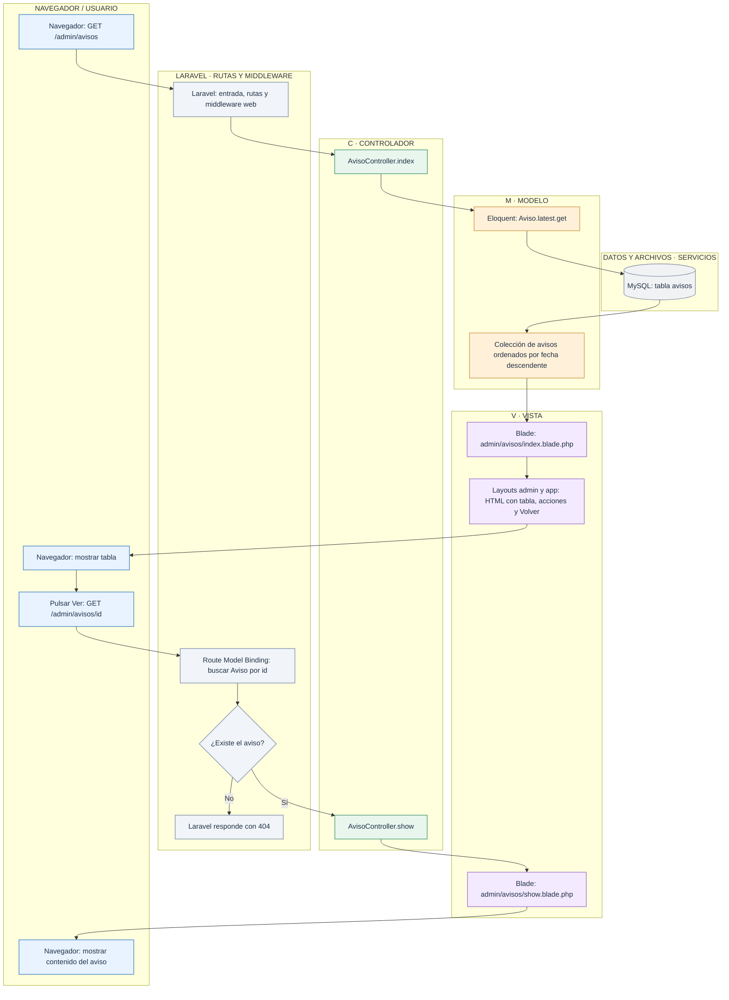
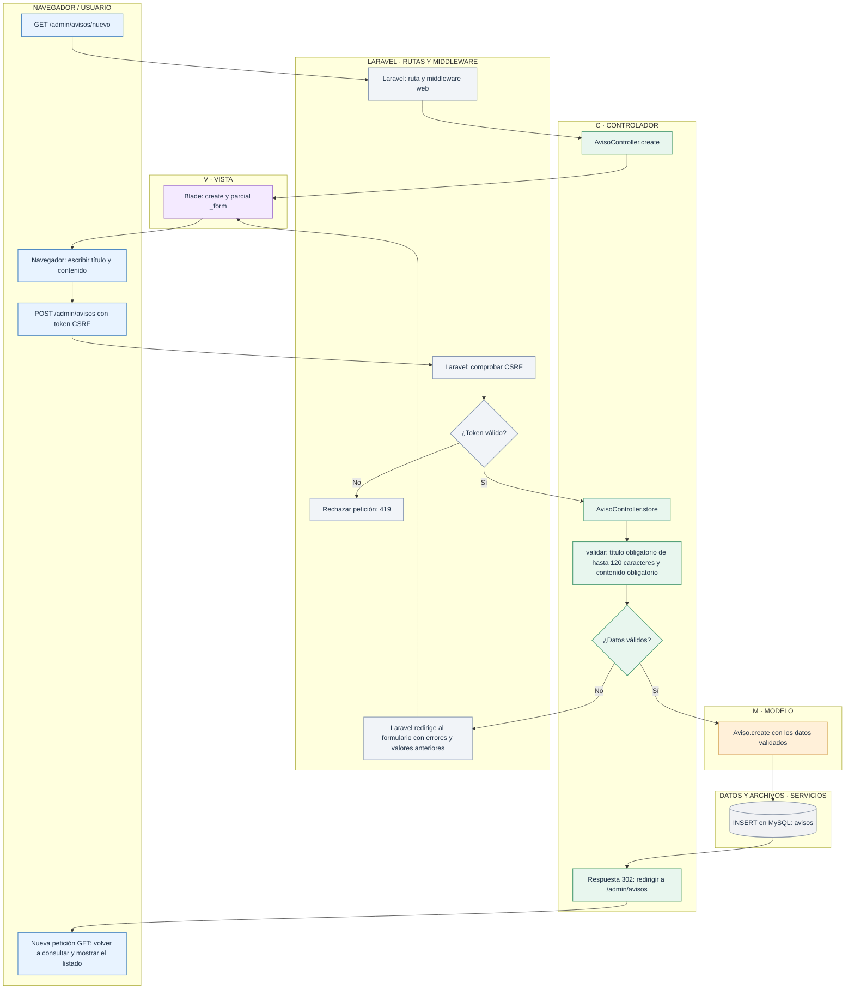
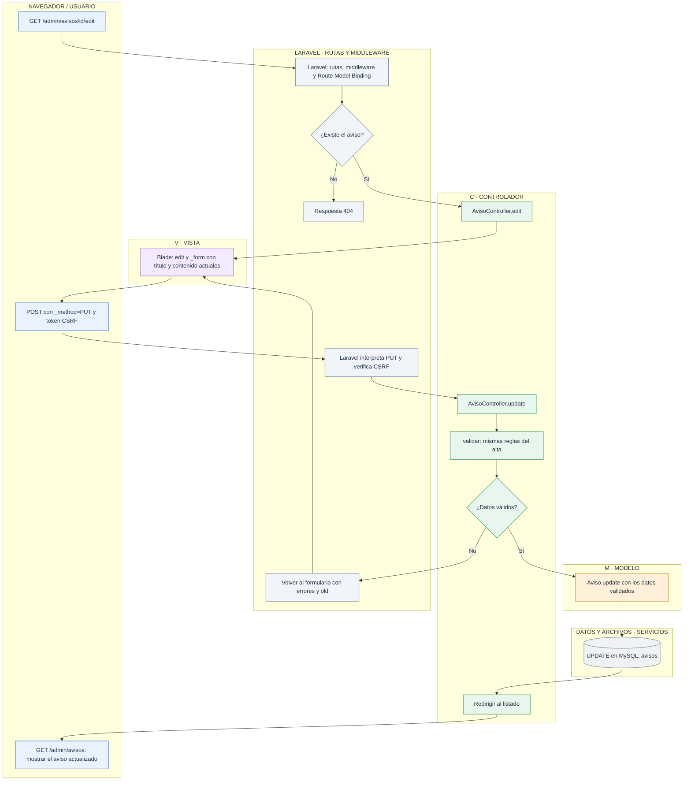
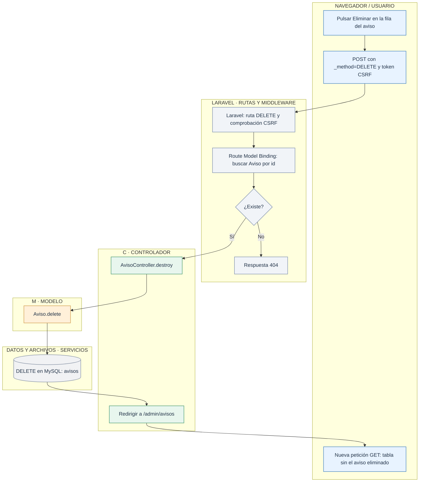

# Laravel en tienda1: gestionar avisos

> **Lectura por capas MVC.** Cada diagrama agrupa los pasos en **C · Controlador**, **M · Modelo** y **V · Vista**. Se separan las actuaciones del navegador, las rutas y el middleware de Laravel y las operaciones de MySQL/Storage porque estos elementos no son, por sí mismos, una capa MVC. Las flechas conservan el orden y las decisiones del flujo original.

Este módulo gestiona los avisos del tablón mediante un CRUD. La petición entra por `public/index.php`, Laravel resuelve la ruta y ejecuta el middleware web antes de llamar a `AvisoController`. El modelo `Aviso` representa la tabla `avisos` de MySQL y Blade genera las pantallas.

La validación se hace en el propio controlador mediante su método privado `validar`, compartido por el alta y la edición. Este módulo no utiliza un FormRequest ni gestiona archivos.

| Petición | Acción de AvisoController | Resultado |
| --- | --- | --- |
| GET `/admin/avisos` | `index` | Tabla de avisos, del más reciente al más antiguo. |
| GET `/admin/avisos/nuevo` | `create` | Formulario de alta. |
| POST `/admin/avisos` | `store` | Aviso creado y redirección al listado. |
| GET `/admin/avisos/{aviso}` | `show` | Detalle del aviso. |
| GET `/admin/avisos/{aviso}/edit` | `edit` | Formulario con el aviso actual. |
| PUT o PATCH `/admin/avisos/{aviso}` | `update` | Aviso actualizado y redirección al listado. |
| DELETE `/admin/avisos/{aviso}` | `destroy` | Aviso eliminado y redirección al listado. |

## 1. Listar y consultar

`index` consulta MySQL; `show` recibe el modelo que Laravel ha encontrado mediante el id de la URL. La vista presenta datos y no ejecuta la consulta.

## 2. Crear un aviso

La redirección provoca una petición nueva. Así, recargar el listado no vuelve a enviar el formulario de alta. No se utiliza `session('ok')` para mostrar mensajes de éxito.

## 3. Editar un aviso

El parcial `_form` se comparte entre alta y edición. `old()` recupera lo escrito si falla la validación; cuando no hay valores anteriores, la edición utiliza los del modelo. Un token CSRF incorrecto se rechaza antes de ejecutar la acción.

## 4. Eliminar un aviso

El botón **Volver** de las altas, los detalles y las ediciones lleva al listado. El del listado lleva al panel de administración. Es navegación y no modifica la base de datos.

## Archivos para seguir el recorrido

- [Rutas](../../routes/web.php).
- [AvisoController](../../app/Http/Controllers/AvisoController.php).
- [Modelo Aviso](../../app/Models/Aviso.php).
- [Listado](../../resources/views/admin/avisos/index.blade.php).
- [Formulario compartido](../../resources/views/admin/avisos/_form.blade.php).
- [Layout administrativo](../../resources/views/layouts/admin.blade.php).
