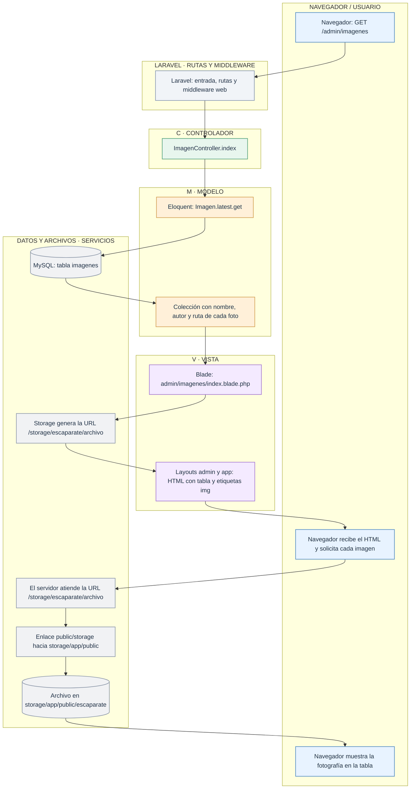
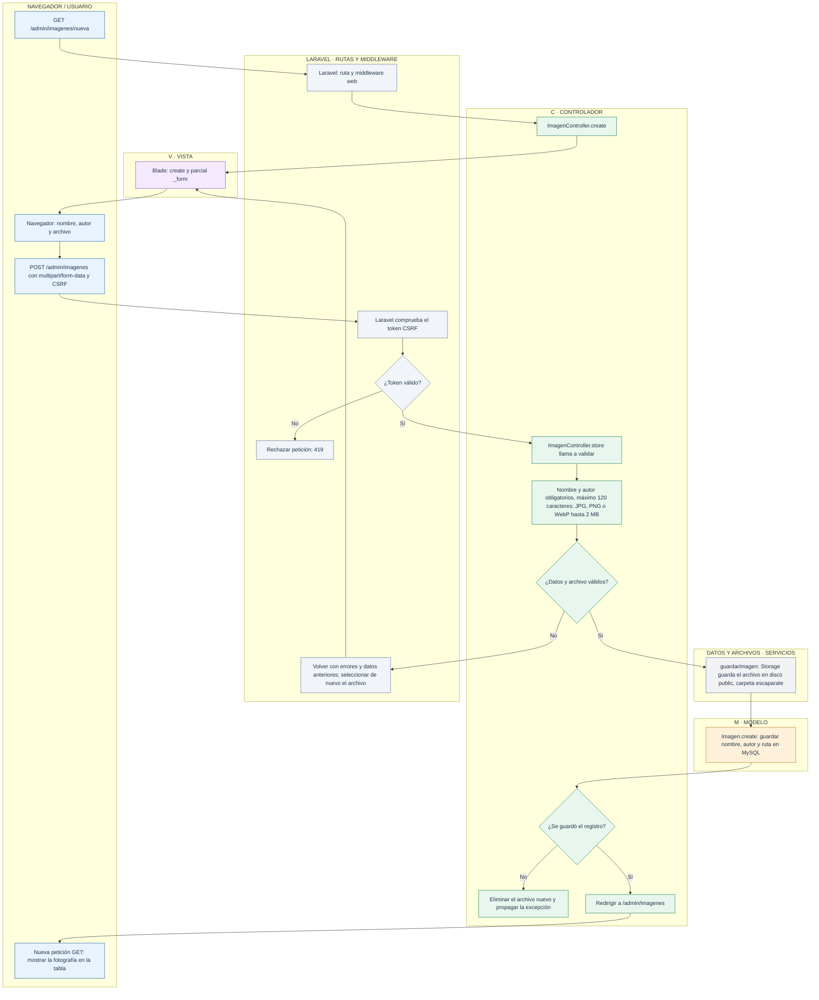
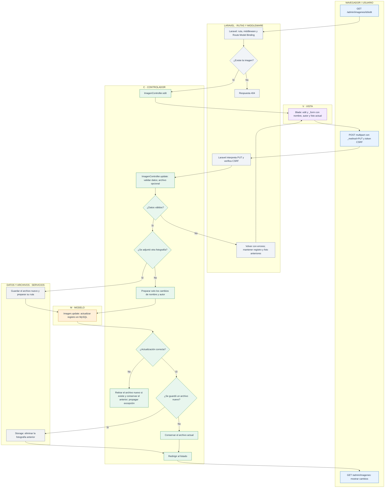
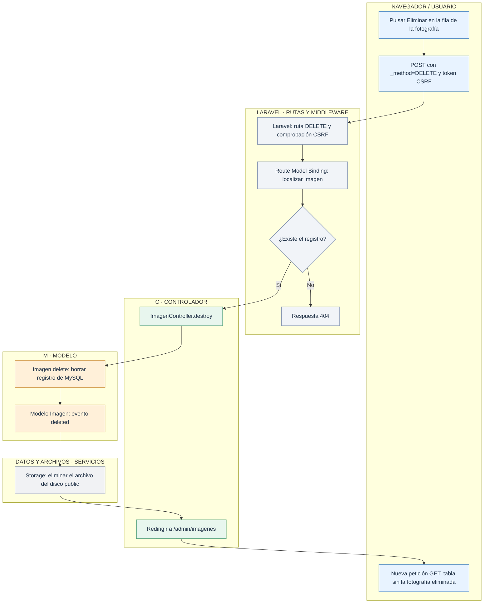

# Laravel en tienda1: gestionar escaparate

> **Lectura por capas MVC.** Cada diagrama agrupa los pasos en **C · Controlador**, **M · Modelo** y **V · Vista**. Se separan las actuaciones del navegador, las rutas y el middleware de Laravel y las operaciones de MySQL/Storage porque estos elementos no son, por sí mismos, una capa MVC. Las flechas conservan el orden y las decisiones del flujo original.

El escaparate administra fotografías independientes de las de productos. Cada registro contiene nombre, autor y ruta del archivo. El modelo se llama `Imagen`, el controlador es `ImagenController` y las rutas utilizan `/admin/imagenes`.

Laravel recibe cada petición por `public/index.php`, resuelve la ruta y ejecuta el middleware web. Eloquent trabaja con MySQL, Storage trabaja con los archivos y Blade construye el HTML que recibe el navegador.

| Petición | Acción de ImagenController | Resultado |
| --- | --- | --- |
| GET `/admin/imagenes` | `index` | Tabla de fotografías con Ver, Editar y Eliminar. |
| GET `/admin/imagenes/nueva` | `create` | Formulario de subida. |
| POST `/admin/imagenes` | `store` | Archivo guardado y registro creado. |
| GET `/admin/imagenes/{imagen}` | `show` | Detalle de la fotografía. |
| GET `/admin/imagenes/{imagen}/edit` | `edit` | Formulario con los datos y la foto actuales. |
| PUT o PATCH `/admin/imagenes/{imagen}` | `update` | Datos actualizados y fotografía sustituida si se adjunta otra. |
| DELETE `/admin/imagenes/{imagen}` | `destroy` | Registro y archivo eliminados. |

## 1. Consultar el listado y mostrar las fotos

La consulta a MySQL no descarga la fotografía: recupera su ruta. El navegador realiza después otra petición para obtener el archivo. `php artisan storage:link` crea el enlace público necesario. Las URLs utilizan el dominio y el puerto desde los que se abre la página.

Para consultar el detalle, `GET /admin/imagenes/{imagen}` activa Route Model Binding. Si el id no existe se responde con 404; si existe, `show` envía el modelo a `admin/imagenes/show.blade.php`.

## 2. Subir una fotografía

El método privado `validar` usa `$request->validate()`: no hay un FormRequest específico para este módulo. El archivo se exige en el alta; el campo de archivo no se puede rellenar automáticamente con `old()`.

## 3. Editar y sustituir una fotografía

La sustitución utiliza dos recursos diferentes: una fila de MySQL y un archivo del disco. El controlador retira el archivo nuevo si falla la escritura del registro. Un token CSRF incorrecto se rechaza antes de ejecutar la acción.

## 4. Eliminar una fotografía

El borrado del archivo se define en el modelo `Imagen`; el controlador solicita eliminar el registro. El botón **Volver** permite regresar al listado o al panel sin modificar los datos.

## Archivos para seguir el recorrido

- [Rutas](../../routes/web.php).
- [ImagenController](../../app/Http/Controllers/ImagenController.php).
- [Modelo Imagen y evento deleted](../../app/Models/Imagen.php).
- [Formulario compartido](../../resources/views/admin/imagenes/_form.blade.php).
- [Listado de fotografías](../../resources/views/admin/imagenes/index.blade.php).
- [Configuración de Storage](../../config/filesystems.php).
