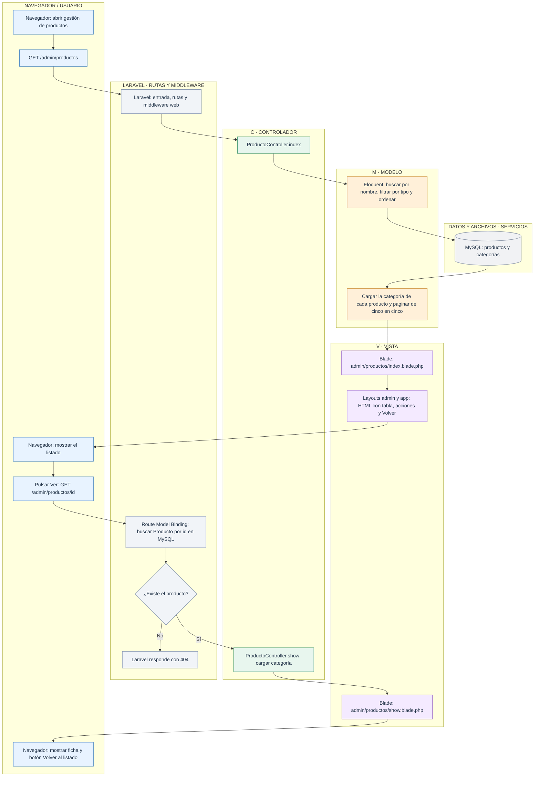
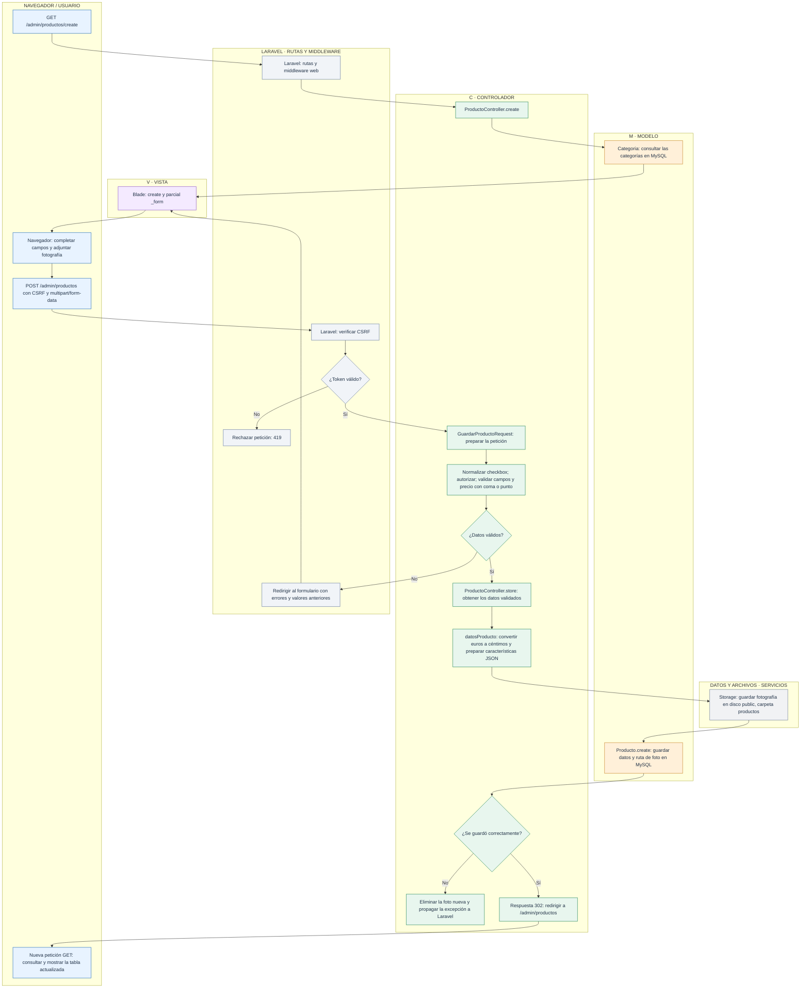
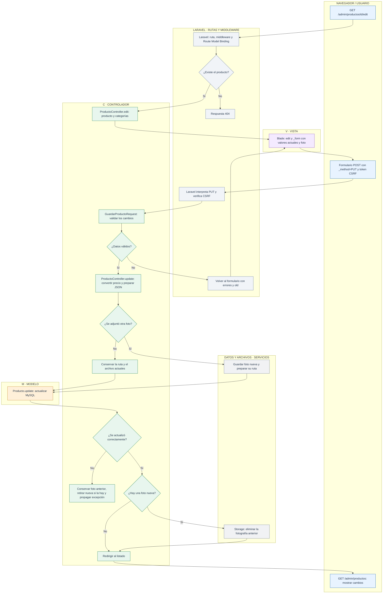
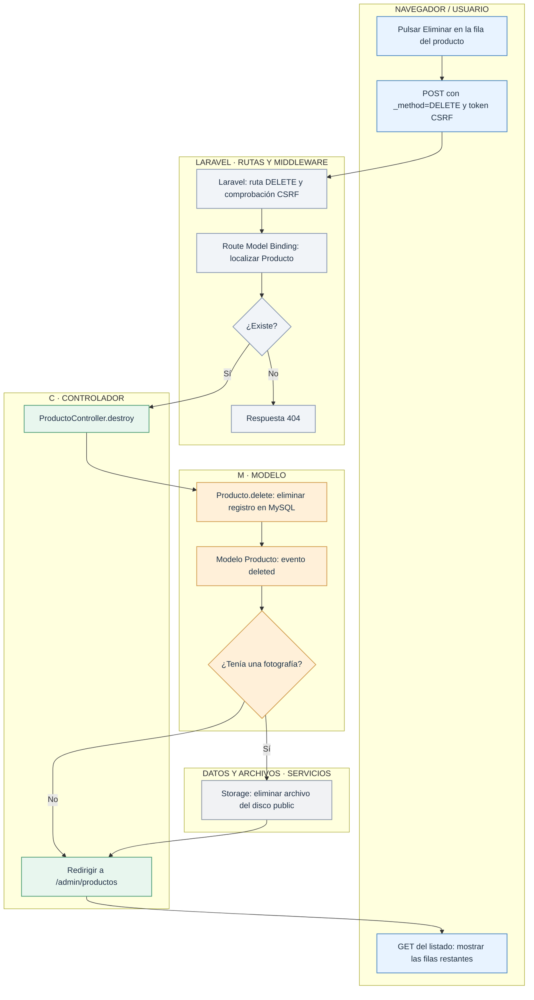

# Laravel en tienda1: gestionar productos

> **Lectura por capas MVC.** Cada diagrama agrupa los pasos en **C · Controlador**, **M · Modelo** y **V · Vista**. Se separan las actuaciones del navegador, las rutas y el middleware de Laravel y las operaciones de MySQL/Storage porque estos elementos no son, por sí mismos, una capa MVC. Las flechas conservan el orden y las decisiones del flujo original.

Estos diagramas describen el código de `tienda1`. Cada petición entra por `public/index.php`, Laravel carga la aplicación y busca la ruta en `routes/web.php`. El middleware web prepara la sesión y comprueba CSRF en los formularios de escritura. No se requiere inicio de sesión.

El controlador organiza la operación, Eloquent consulta o modifica MySQL y Blade genera el HTML. Los archivos de las fotografías se guardan en disco; MySQL conserva sus rutas.

| Petición | Acción de ProductoController | Resultado |
| --- | --- | --- |
| GET `/admin/productos` | `index` | Tabla con búsqueda, filtro y paginación. |
| GET `/admin/productos/create` | `create` | Formulario de alta y categorías disponibles. |
| POST `/admin/productos` | `store` | Producto guardado y redirección al listado. |
| GET `/admin/productos/{producto}` | `show` | Detalle del producto. |
| GET `/admin/productos/{producto}/edit` | `edit` | Formulario con los datos actuales. |
| PUT o PATCH `/admin/productos/{producto}` | `update` | Producto actualizado y redirección al listado. |
| DELETE `/admin/productos/{producto}` | `destroy` | Producto y fotografía eliminados. |

## 1. Consultar el listado y un producto

`with('categoria')` permite obtener las categorías sin hacer una consulta por cada fila. `withQueryString()` conserva los filtros al cambiar de página.

## 2. Crear un producto

`GuardarProductoRequest` se ejecuta antes de entrar en `store`. La normalización y las reglas forman parte de esa preparación. Si la validación falla, el controlador no crea el producto ni guarda el archivo.

El usuario introduce, por ejemplo, `24,50`. El controlador guarda `2450` en `precio_centimos`. El tipo se convierte mediante `TipoProducto` y las características se almacenan como JSON.

## 3. Editar un producto

La fotografía es opcional en edición. La anterior se elimina después de guardar correctamente la sustitución. La rama de validación presupone que el middleware ha aceptado el token CSRF; un token incorrecto se rechaza antes del controlador.

## 4. Eliminar un producto

Esta es la administración de `tienda1`: no intervienen clientes, carrito ni pedidos. El botón **Volver** navega al listado o al panel; no guarda ni elimina datos.

## Archivos para seguir el recorrido

- [Rutas](../../routes/web.php).
- [ProductoController](../../app/Http/Controllers/ProductoController.php).
- [GuardarProductoRequest](../../app/Http/Requests/GuardarProductoRequest.php).
- [Producto](../../app/Models/Producto.php) y [Categoria](../../app/Models/Categoria.php).
- [Formulario compartido](../../resources/views/admin/productos/_form.blade.php).
- [Layout administrativo](../../resources/views/layouts/admin.blade.php).
