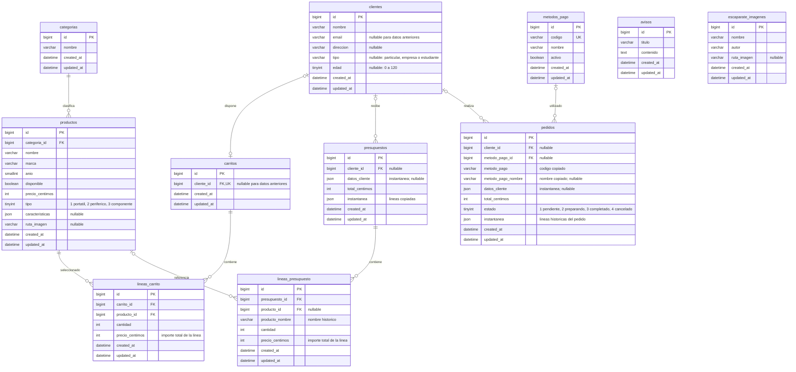

# Modelo de datos compartido por Admin y Usuario

[Índice de diagramas](README.md) · **Arquitectura compartida**

Este diagrama pertenece a la **M de MVC**: refleja las tablas de negocio de MySQL que utilizan los modelos Eloquent. Los controladores y las vistas aparecen en los documentos de cada área, no como tablas. Se muestran las columnas relevantes, incluidos los timestamps.

`PK` identifica la clave primaria; `FK`, una clave foránea; `UK`, una restricción única. `||` significa uno obligatorio, `|o`/`o|` cero o uno y `o{` cero o muchos. La asociación con cliente admite NULL por los datos históricos y las reglas de borrado; las nuevas operaciones de compra exigen cliente.

| Modelo Eloquent | Tabla | Uso en Admin | Uso en Usuario |
| --- | --- | --- | --- |
| Categoria | categorias | Opciones de productos. | Categorías con productos. |
| Producto | productos | CRUD. | Catálogo, carrito y documentos. |
| Aviso | avisos | CRUD. | Tablón de lectura. |
| Imagen | escaparate_imagenes | CRUD y archivos. | Galería de lectura. |
| Cliente | clientes | CRUD y consulta comercial. | Tu Espacio y ficha persistente. |
| Carrito / LineaCarrito | carritos / lineas_carrito | Acceso desde cliente. | Selección y compra. |
| Presupuesto / LineaPresupuesto | presupuestos / lineas_presupuesto | Sin CRUD propio. | Generación y consulta histórica. |
| MetodoPago | metodos_pago | CRUD. | Selección de métodos activos. |
| Pedido | pedidos | Consulta y cambio de estado. | Compra e histórico. |

## Restricciones y conservación de datos

- `carritos.cliente_id` es único: cada cliente tiene como máximo un carrito.
- La pareja **carrito_id + producto_id** de `lineas_carrito` es única: productos iguales acumulan unidades e importes en una línea.
- Borrar cliente elimina su carrito y las líneas de ese carrito por cascada; deja a NULL el cliente de pedidos y presupuestos.
- Borrar presupuesto elimina sus líneas. Borrar producto deja a NULL su referencia en las líneas de presupuesto, conservando nombre e importes históricos.
- Las líneas de carrito impiden borrar productos seleccionados; el controlador comprueba esta situación antes del DELETE.
- Borrar método de pago deja a NULL su referencia en pedidos; los nombres y códigos copiados se conservan.
- Los productos de los **pedidos** se guardan en JSON; no existe una tabla de líneas de pedido. Los **presupuestos** tienen JSON y líneas relacionales.
- Los importes son enteros en céntimos. Los códigos de `EstadoPedido` y `TipoProducto` también son enteros. `clientes.tipo` es un texto y no es `TipoProducto`.

Se omiten las tablas técnicas de Laravel (usuarios, sesiones, caché y colas), que no forman parte de estos módulos de negocio. Las imágenes son archivos: sus columnas guardan rutas, no binarios.

## Archivos para seguir el recorrido

- **Modelos de catálogo y contenido:** [Categoria](../app/Models/Categoria.php) · [Producto](../app/Models/Producto.php) · [Aviso](../app/Models/Aviso.php) · [Imagen](../app/Models/Imagen.php).
- **Modelos de cliente y carrito:** [Cliente](../app/Models/Cliente.php) · [Carrito](../app/Models/Carrito.php) · [LineaCarrito](../app/Models/LineaCarrito.php).
- **Modelos de documentos y pago:** [Presupuesto](../app/Models/Presupuesto.php) · [LineaPresupuesto](../app/Models/LineaPresupuesto.php) · [MetodoPago](../app/Models/MetodoPago.php) · [Pedido](../app/Models/Pedido.php).
- **Tipos y estados:** [Tipos de producto](../app/Enums/TipoProducto.php) · [Estados de pedido](../app/Enums/EstadoPedido.php).
- **Esquema de MySQL:** [Migraciones y claves foráneas](../database/migrations).
