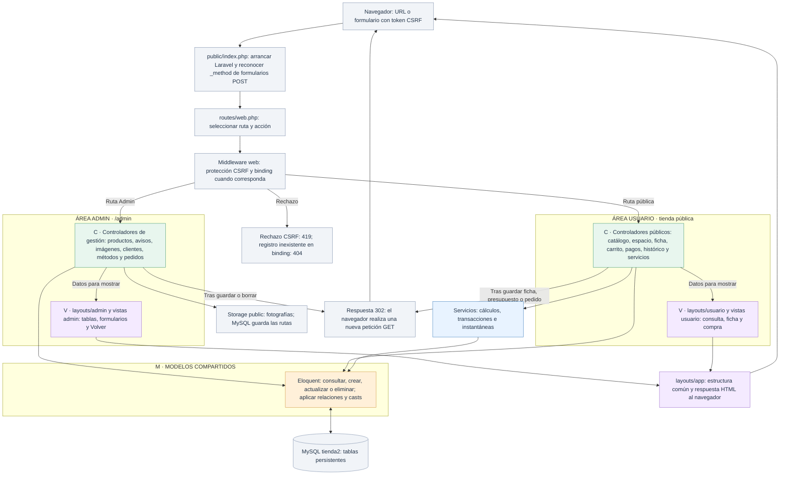

# MVC en tienda2: Admin y Usuario

[Índice de diagramas](README.md) · **Arquitectura compartida**

Los archivos muestran el funcionamiento del código actual de `tienda2`. Las dos áreas tienen rutas, controladores y vistas diferenciados y comparten los modelos y la misma base MySQL.

| Color | Responsabilidad | Ejemplos |
| --- | --- | --- |
| Verde | **C · Controlador:** coordinar la petición, llamar a modelos o servicios y decidir la respuesta. | `ProductoController`, `TiendaController`, `CarritoController` |
| Naranja | **M · Modelo:** registros, relaciones, casts y operaciones Eloquent. | `Producto`, `Cliente`, `Carrito`, `Pedido` |
| Violeta | **V · Vista:** formularios, tablas, datos y enlaces en Blade. | `resources/views/admin` y `resources/views/usuario` |
| Azul | Servicios y dominio, separados de las tres capas. | `ServicioPresupuestos`, `ServicioPedidos`, `ServicioPrecioMontaje` |
| Gris | Rutas, middleware, MySQL y archivos; se identifican por el nombre del bloque. | `routes/web.php`, CSRF, Storage |

La validación HTTP y los FormRequest se dibujan en el bloque de Laravel, antes de persistir. MySQL no es el modelo: Eloquent es la capa que opera sobre sus tablas. Las reglas de los servicios no se atribuyen a Blade ni se confunden con los controladores.

## Recorrido de una petición

Las flechas Modelo–MySQL representan acceso a datos; las flechas Controlador–Vista representan la preparación de la respuesta. Tras usar un servicio, el controlador recupera el resultado y elige su vista o redirección.

## Formularios de escritura

Los formularios HTML envían POST. Para una edición se añade `@method('PUT')`; para una eliminación, `@method('DELETE')`. Todos incluyen `@csrf`. Las directivas se escriben separadas para que Blade genere los campos ocultos `_token` y `_method`.

La protección CSRF de Laravel comprueba el origen o el token según los datos de la petición. Los errores de validación de formularios web redirigen con mensajes y valores anteriores. Las excepciones no capturadas pasan al manejador de Laravel.

El cliente de la compra viaja en `cliente_id`, no en una sesión de selección. No hay inicio de sesión. Laravel mantiene sus mecanismos técnicos de formularios y CSRF.

## Diferencia entre las áreas

| Función | Admin | Usuario |
| --- | --- | --- |
| Productos, avisos y escaparate | Crear, consultar, editar y eliminar. | Consultar; añadir productos al carrito. |
| Clientes | CRUD de gestión. | Elegir cliente; crear o actualizar su ficha persistente. |
| Métodos de pago | CRUD y disponibilidad. | Elegir un método activo al pagar. |
| Carrito y presupuestos | Accesos desde la ficha administrativa del cliente. | Preparar carrito, agrupar unidades y generar presupuestos. |
| Pedidos | Consultar e histórico; modificar únicamente estado. | Crear mediante la compra simulada y consultar histórico. |
| Cálculos de servicios | Sin formularios propios. | Envío, montaje y financiación sin persistencia. |

Los módulos retirados no forman parte de los diagramas. [Modelo de datos compartido](MODELO_DATOS.md).

## Archivos para seguir el recorrido

- **Punto de entrada y rutas:** [Entrada pública](../public/index.php) · [Rutas web](../routes/web.php).
- **Controladores de ejemplo:** [ProductoController](../app/Http/Controllers/ProductoController.php) · [TiendaController](../app/Http/Controllers/TiendaController.php) · [CarritoController](../app/Http/Controllers/CarritoController.php).
- **Modelos Eloquent de ejemplo:** [Producto](../app/Models/Producto.php) · [Cliente](../app/Models/Cliente.php) · [Carrito](../app/Models/Carrito.php) · [Pedido](../app/Models/Pedido.php).
- **Layouts Blade:** [Layout general](../resources/views/layouts/app.blade.php) · [Layout administrativo](../resources/views/layouts/admin.blade.php) · [Layout público](../resources/views/layouts/usuario.blade.php).
- **Infraestructura:** [Discos de archivos](../config/filesystems.php) · [Migraciones de datos](../database/migrations).
