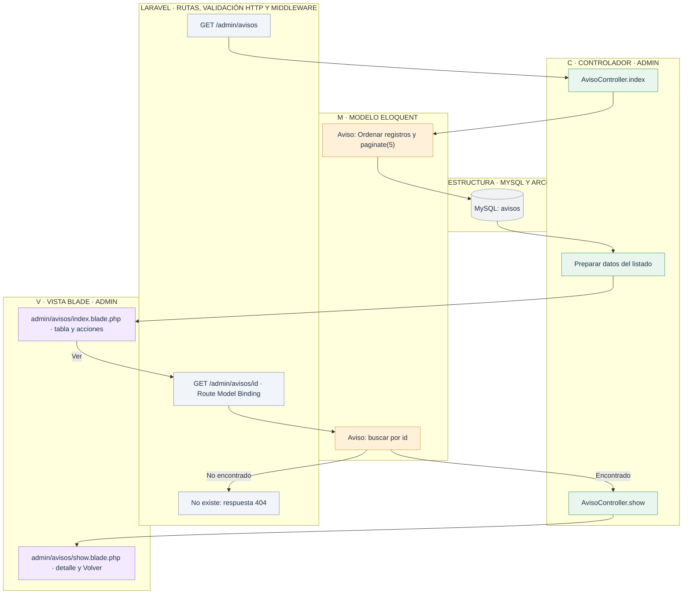
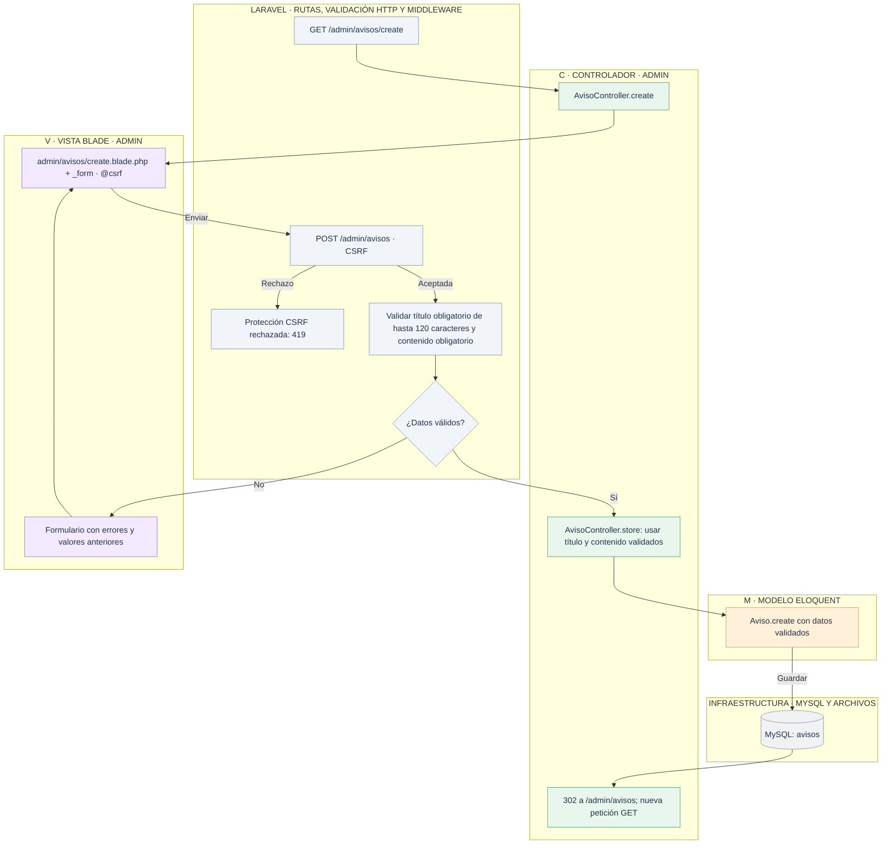
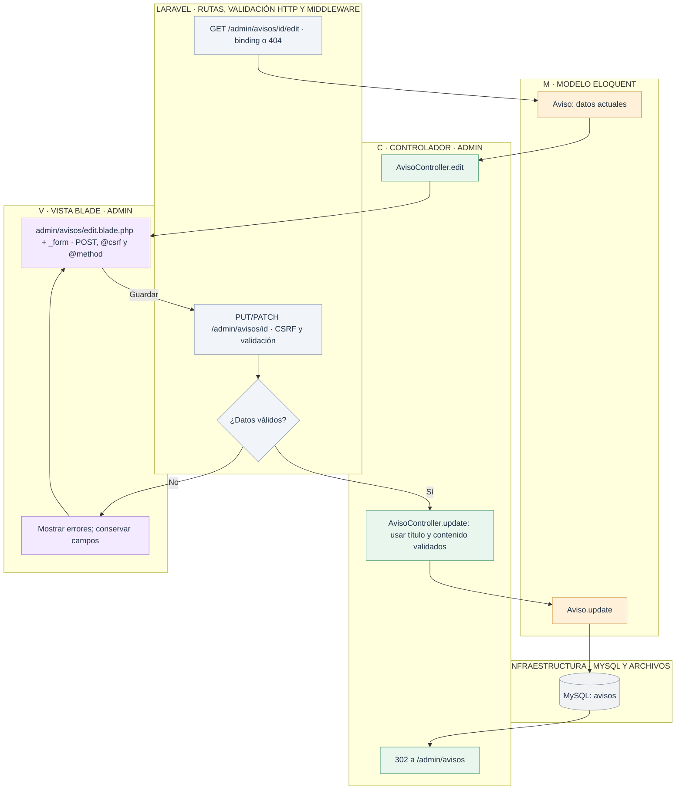
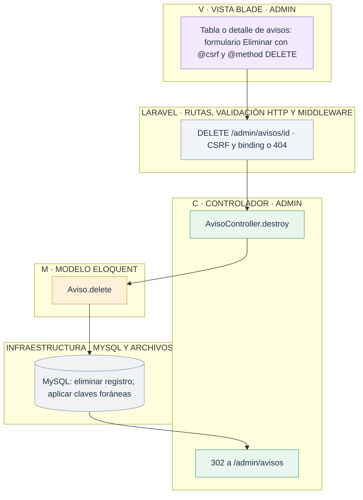

# Admin: gestionar avisos

[Índice de diagramas](../README.md) · **Área Admin**

Los diagramas describen `AvisoController`, el modelo `Aviso` y las vistas `resources/views/admin/avisos` de **tienda2**. Las tablas de gestión tienen cinco registros por página y paginación numerada. Las rutas de edición aceptan PUT o PATCH; los formularios HTML usan POST con `@method('PUT')` y `@csrf` en líneas separadas.

| Petición | Método del controlador |
| --- | --- |
| GET `/admin/avisos` | `index` |
| GET `/admin/avisos/create` | `create` |
| POST `/admin/avisos` | `store` |
| GET `/admin/avisos/{aviso}` | `show` |
| GET `/admin/avisos/{aviso}/edit` | `edit` |
| PUT/PATCH `/admin/avisos/{aviso}` | `update` |
| DELETE `/admin/avisos/{aviso}` | `destroy` |

## 1. Listar y consultar

## 2. Crear

## 3. Editar

## 4. Eliminar

La consulta pública se realiza aparte con `TiendaController.avisos`; allí no hay controles de gestión.
