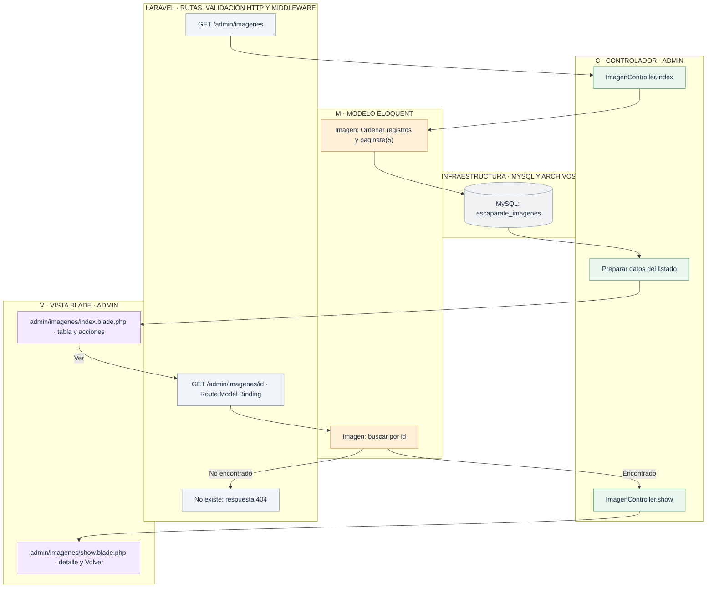
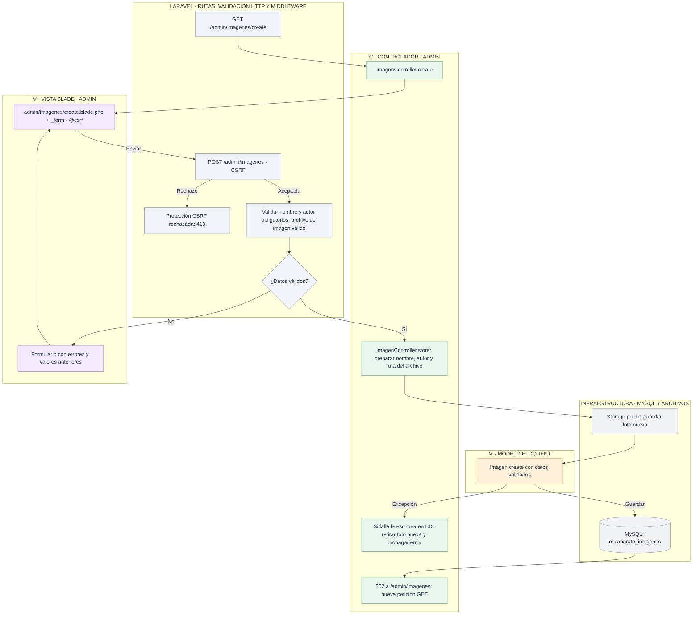
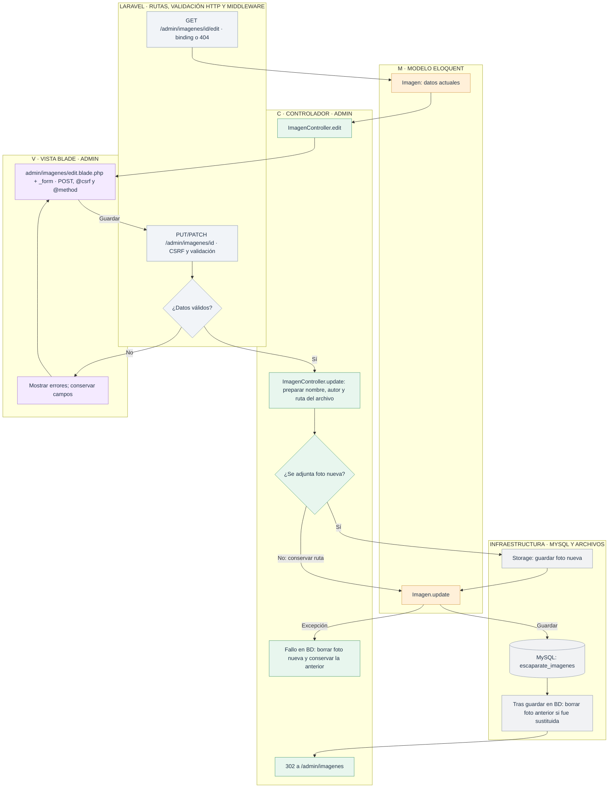
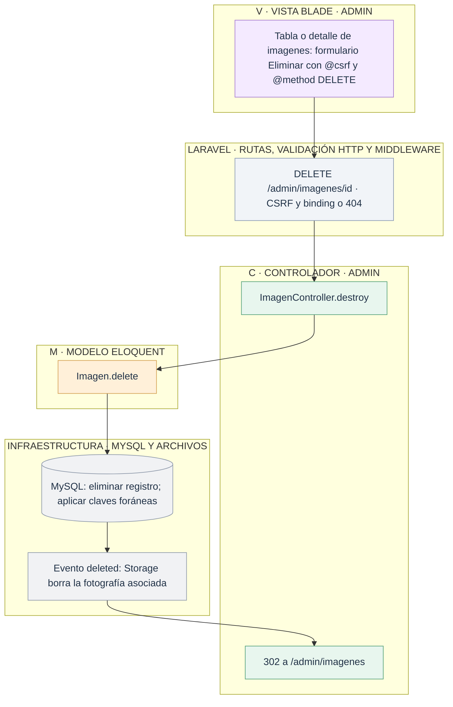

# Admin: gestionar el escaparate

[Índice de diagramas](../README.md) · **Área Admin**

Los diagramas describen `ImagenController`, el modelo `Imagen` y las vistas `resources/views/admin/imagenes` de **tienda2**. Las tablas de gestión tienen cinco registros por página y paginación numerada. Las rutas de edición aceptan PUT o PATCH; los formularios HTML usan POST con `@method('PUT')` y `@csrf` en líneas separadas.

| Petición | Método del controlador |
| --- | --- |
| GET `/admin/imagenes` | `index` |
| GET `/admin/imagenes/create` | `create` |
| POST `/admin/imagenes` | `store` |
| GET `/admin/imagenes/{imagen}` | `show` |
| GET `/admin/imagenes/{imagen}/edit` | `edit` |
| PUT/PATCH `/admin/imagenes/{imagen}` | `update` |
| DELETE `/admin/imagenes/{imagen}` | `destroy` |

## 1. Listar y consultar

## 2. Crear

## 3. Editar

## 4. Eliminar

El modelo sigue llamándose `Imagen` y declara explícitamente la tabla `escaparate_imagenes`. La galería pública solo consulta sus registros.

Las fotos son archivos del disco `public`; MySQL guarda sus rutas. Si el archivo de ejemplo no existe, la vista de productos muestra un marcador.

## Archivos para seguir el recorrido

- **Entrada HTTP:** [Rutas web](../../routes/web.php).
- **Controlador:** [ImagenController](../../app/Http/Controllers/ImagenController.php).
- **Modelos:** [Imagen](../../app/Models/Imagen.php).
- **Vistas Blade:** [index](../../resources/views/admin/imagenes/index.blade.php) · [show](../../resources/views/admin/imagenes/show.blade.php) · [create](../../resources/views/admin/imagenes/create.blade.php) · [edit](../../resources/views/admin/imagenes/edit.blade.php) · [_form](../../resources/views/admin/imagenes/_form.blade.php).
- **Validación y soporte:** [Configuración del almacenamiento](../../config/filesystems.php).
- **Layouts:** [Layout general](../../resources/views/layouts/app.blade.php) · [Layout administrativo](../../resources/views/layouts/admin.blade.php).
