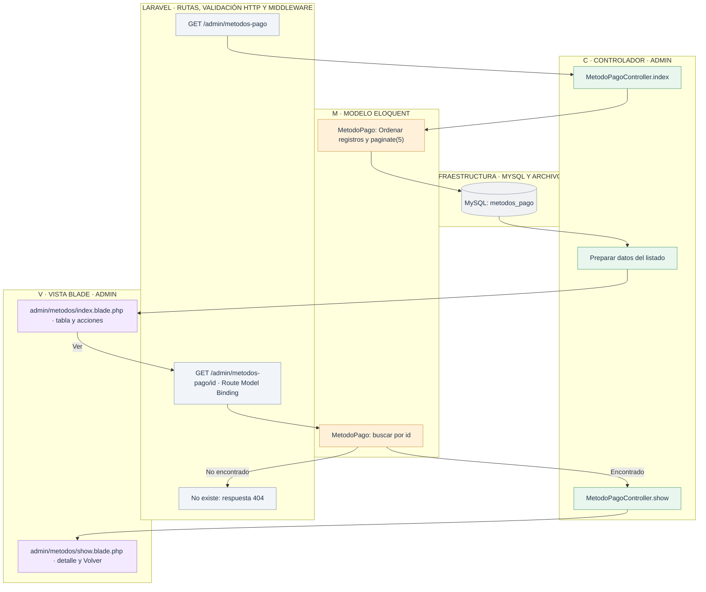
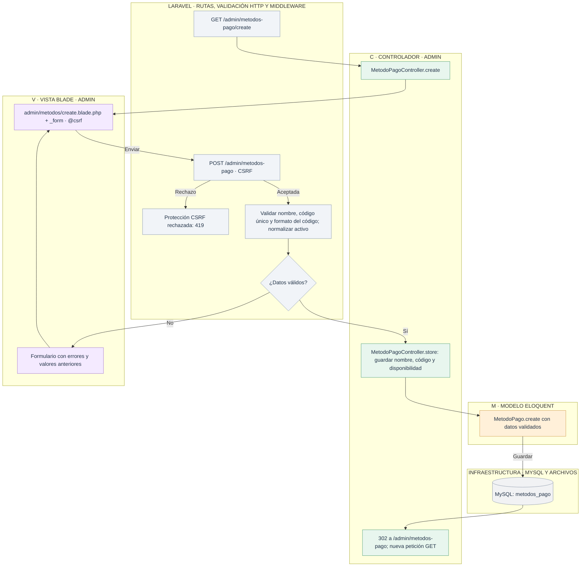
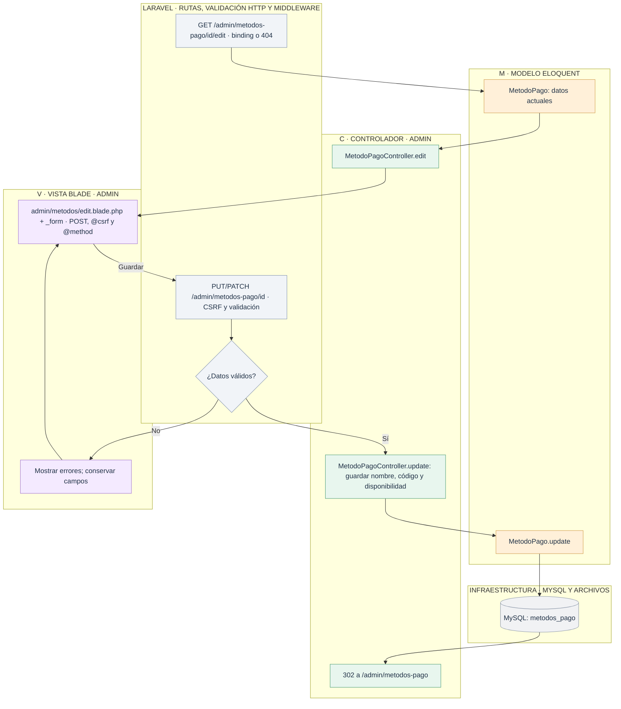
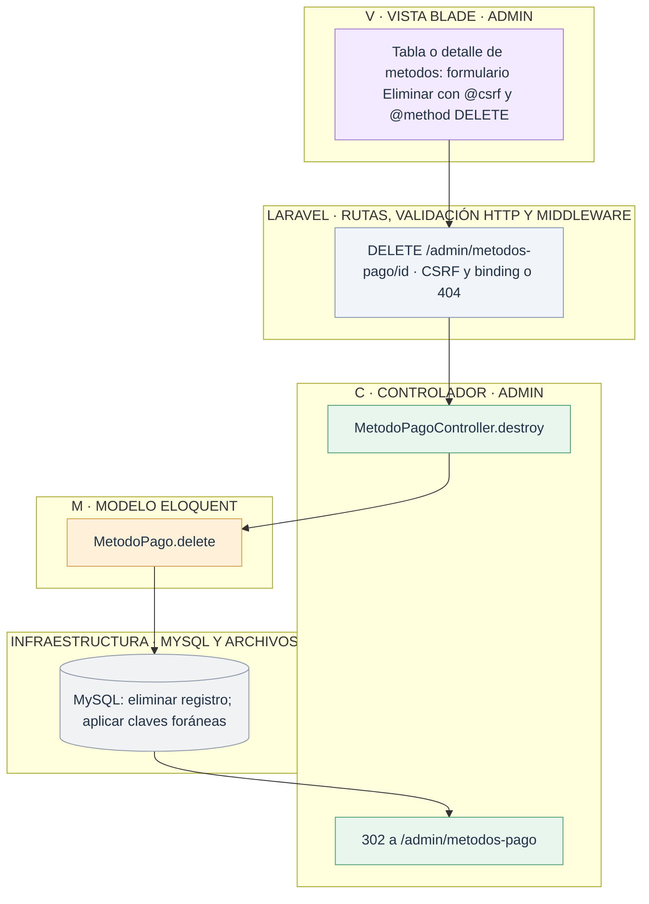

# Admin: gestionar métodos de pago

[Índice de diagramas](../README.md) · **Área Admin**

Los diagramas describen `MetodoPagoController`, el modelo `MetodoPago` y las vistas `resources/views/admin/metodos` de **tienda2**. Las tablas de gestión tienen cinco registros por página y paginación numerada. Las rutas de edición aceptan PUT o PATCH; los formularios HTML usan POST con `@method('PUT')` y `@csrf` en líneas separadas.

| Petición | Método del controlador |
| --- | --- |
| GET `/admin/metodos-pago` | `index` |
| GET `/admin/metodos-pago/create` | `create` |
| POST `/admin/metodos-pago` | `store` |
| GET `/admin/metodos-pago/{metodo}` | `show` |
| GET `/admin/metodos-pago/{metodo}/edit` | `edit` |
| PUT/PATCH `/admin/metodos-pago/{metodo}` | `update` |
| DELETE `/admin/metodos-pago/{metodo}` | `destroy` |

## 1. Listar y consultar

## 2. Crear

## 3. Editar

## 4. Eliminar

Un método inactivo no puede elegirse al pagar. La validación de edición ignora el propio registro al comprobar el código único. Al borrarlo, pedidos.metodo_pago_id pasa a NULL; el código y el nombre copiados en el pedido se conservan.
