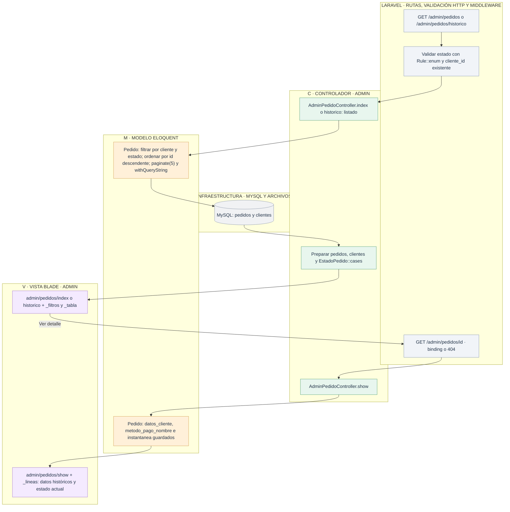
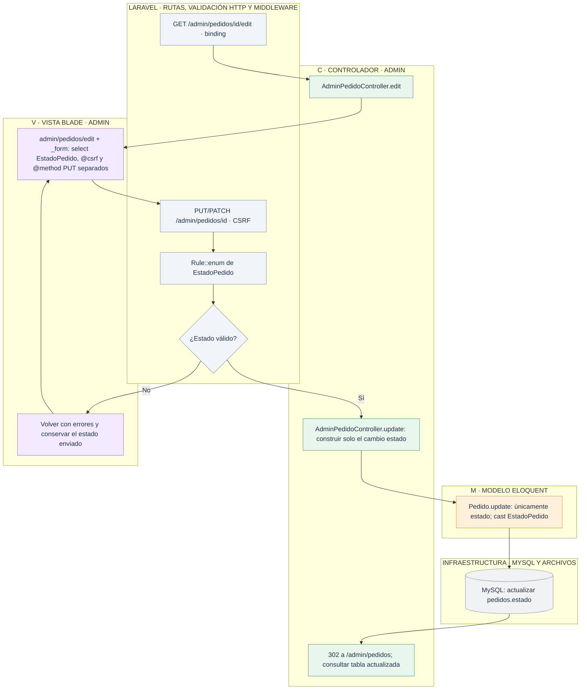

# Admin: consultar pedidos y cambiar su estado

[Índice de diagramas](../README.md) · **Área Admin**

`AdminPedidoController` no permite crear ni eliminar pedidos. El formulario de modificación acepta únicamente el estado; cliente, método, productos e importes se conservan.

| Petición | Acción |
| --- | --- |
| GET `/admin/pedidos` | `index` |
| GET `/admin/pedidos/historico` | `historico` |
| GET `/admin/pedidos/{pedido}` | `show` |
| GET `/admin/pedidos/{pedido}/edit` | `edit` |
| PUT/PATCH `/admin/pedidos/{pedido}` | `update` |

## Consultar gestión e histórico

## Cambiar únicamente el estado

`EstadoPedido` es un enum de enteros: **1** pendiente de cobro, **2** en preparación, **3** completado y **4** cancelado. Cambiar el estado no vuelve a calcular precios ni altera las instantáneas. Un registro inexistente produce 404; una petición de escritura rechazada por CSRF produce 419.

## Archivos para seguir el recorrido

- **Entrada HTTP:** [Rutas web](../../routes/web.php).
- **Controlador:** [AdminPedidoController](../../app/Http/Controllers/AdminPedidoController.php).
- **Modelos:** [Pedido](../../app/Models/Pedido.php) · [Cliente](../../app/Models/Cliente.php) · [MetodoPago](../../app/Models/MetodoPago.php).
- **Vistas Blade:** [index](../../resources/views/admin/pedidos/index.blade.php) · [historico](../../resources/views/admin/pedidos/historico.blade.php) · [show](../../resources/views/admin/pedidos/show.blade.php) · [edit](../../resources/views/admin/pedidos/edit.blade.php) · [_filtros](../../resources/views/admin/pedidos/_filtros.blade.php) · [_tabla](../../resources/views/admin/pedidos/_tabla.blade.php) · [_lineas](../../resources/views/admin/pedidos/_lineas.blade.php) · [_form](../../resources/views/admin/pedidos/_form.blade.php).
- **Validación y soporte:** [Enum de estados](../../app/Enums/EstadoPedido.php).
- **Layouts:** [Layout general](../../resources/views/layouts/app.blade.php) · [Layout administrativo](../../resources/views/layouts/admin.blade.php).
