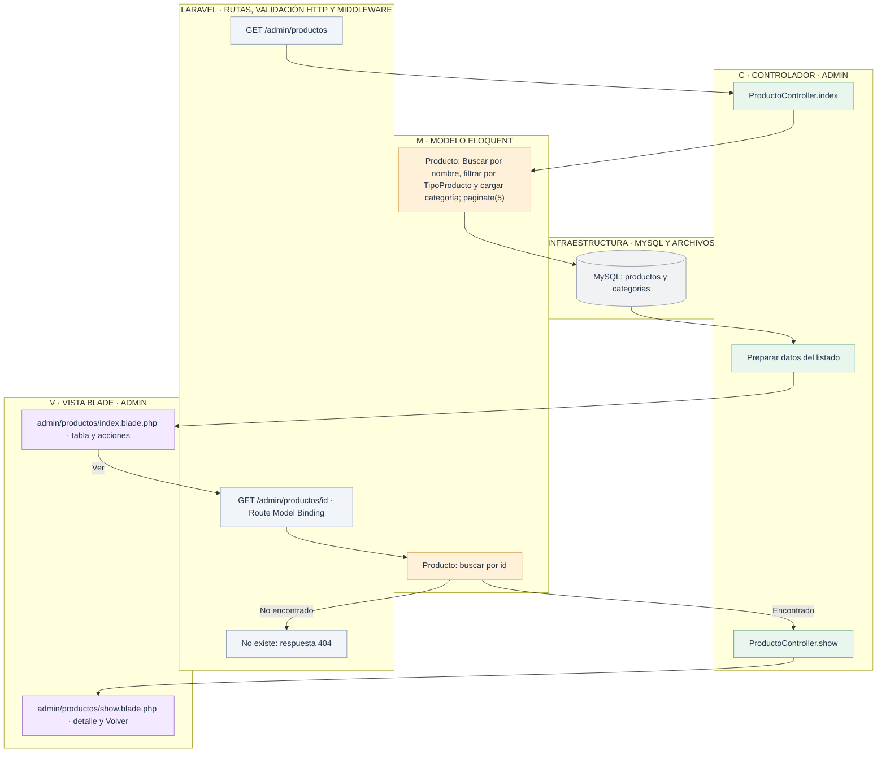
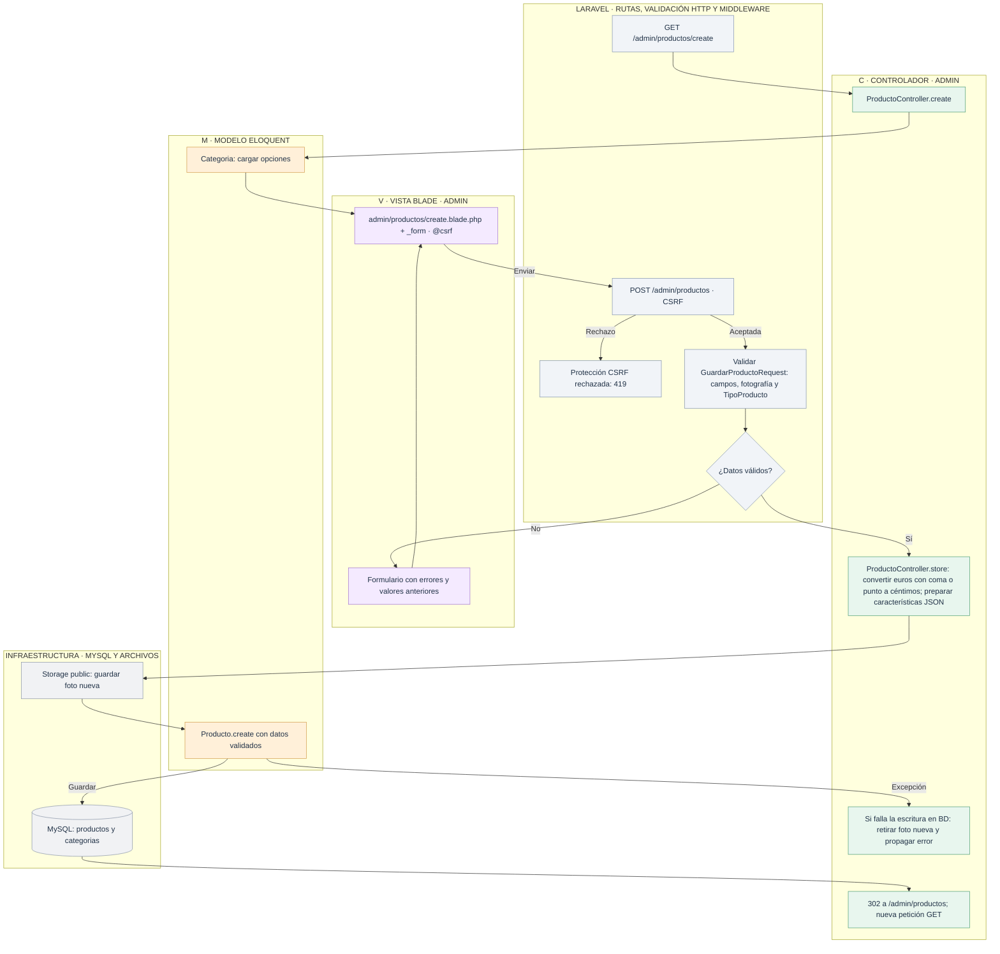
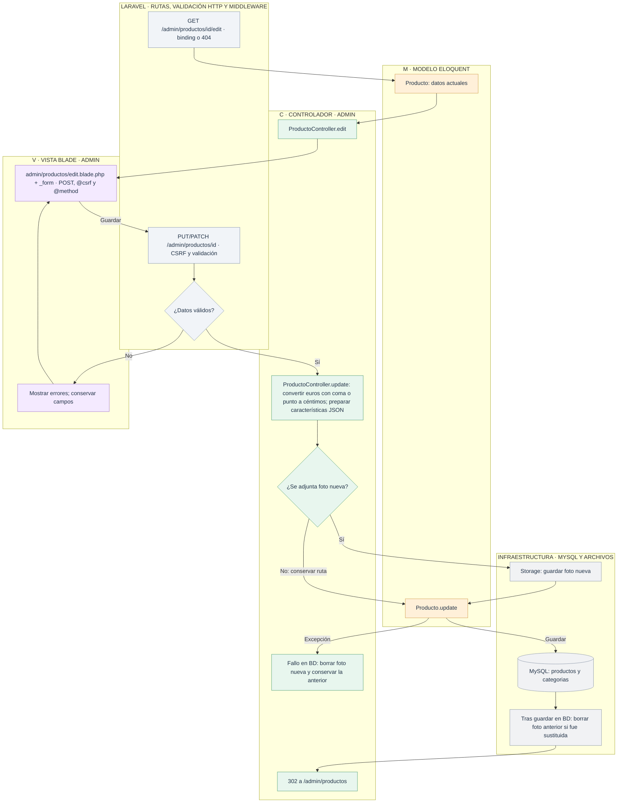
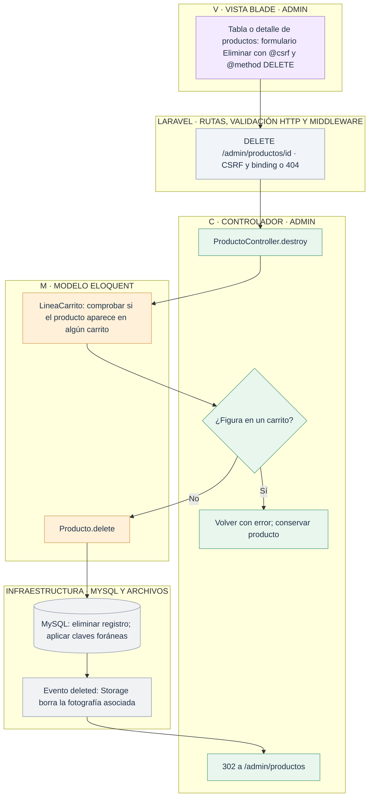

# Admin: gestionar productos

[Índice de diagramas](../README.md) · **Área Admin**

Los diagramas describen `ProductoController`, el modelo `Producto` y las vistas `resources/views/admin/productos` de **tienda2**. Las tablas de gestión tienen cinco registros por página y paginación numerada. Las rutas de edición aceptan PUT o PATCH; los formularios HTML usan POST con `@method('PUT')` y `@csrf` en líneas separadas.

| Petición | Método del controlador |
| --- | --- |
| GET `/admin/productos` | `index` |
| GET `/admin/productos/create` | `create` |
| POST `/admin/productos` | `store` |
| GET `/admin/productos/{producto}` | `show` |
| GET `/admin/productos/{producto}/edit` | `edit` |
| PUT/PATCH `/admin/productos/{producto}` | `update` |
| DELETE `/admin/productos/{producto}` | `destroy` |

## 1. Listar y consultar

## 2. Crear

## 3. Editar

## 4. Eliminar

El tipo se guarda con el enum entero `TipoProducto`: 1 portátil, 2 periférico y 3 componente. Los presupuestos conservan sus datos históricos aunque se elimine el producto.

Las fotos son archivos del disco `public`; MySQL guarda sus rutas. Si el archivo de ejemplo no existe, la vista de productos muestra un marcador.
