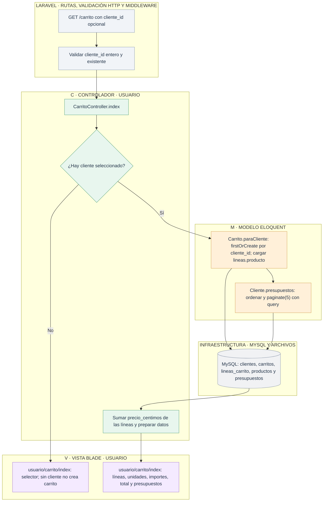
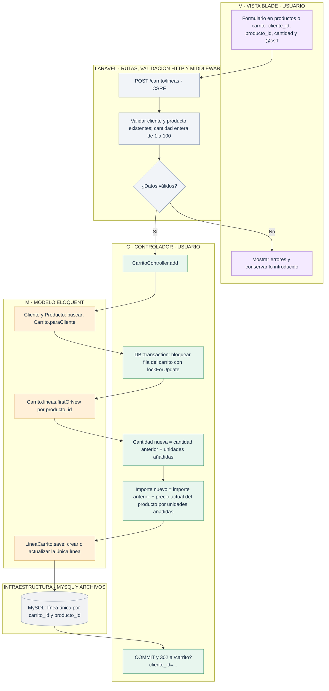

# Usuario: consultar el carrito y sumar productos repetidos

[Índice de diagramas](../README.md) · **Área Usuario**

`CarritoController.index` muestra el carrito del cliente elegido. `add` suma unidades e importes de un producto en **una sola línea**. El precio no se toma del formulario.

## Consultar el carrito

## Añadir un producto o acumular más unidades

`lineas_carrito.precio_centimos` es el **importe completo de la línea**, no su precio unitario. Si se añaden 2 unidades a 10 € y después 3 a 12 €, queda una línea de 5 unidades y 56 €. Consultar el carrito no recalcula el importe con el catálogo. Con un precio sin cambios de 10 €, 2 + 3 unidades suman 50 €.

La migración agrupa los duplicados anteriores sumando cantidades e importes y establece una restricción única. La transacción de alta usa el mismo bloqueo del carrito que el pago; si falla una escritura, no se confirma la suma. [Generar presupuesto](presupuestos.md) · [Comprar](compra.md).
