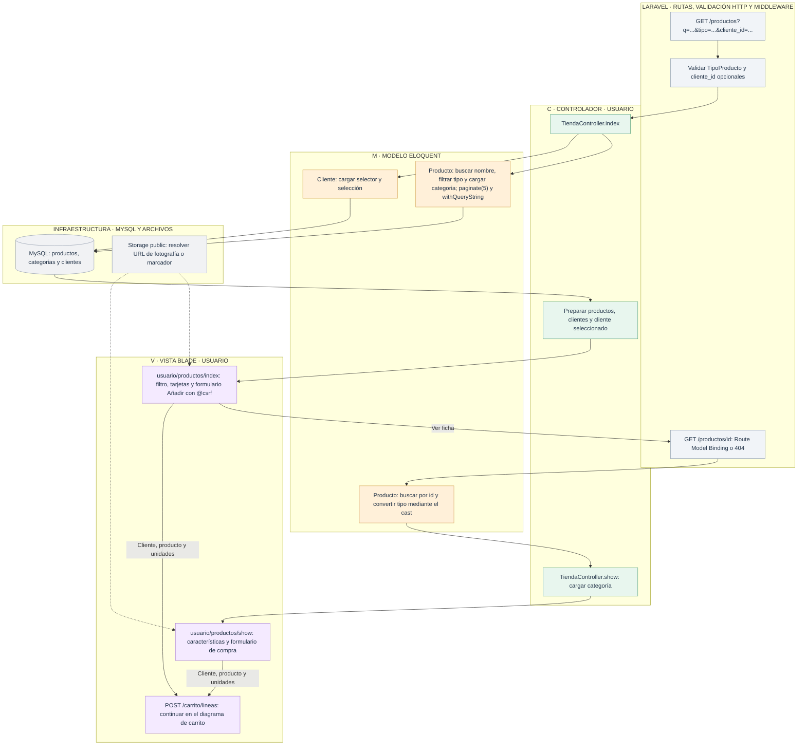

# Usuario: consultar el catálogo y los productos

[Índice de diagramas](../README.md) · **Área Usuario**

El catálogo público está en **`/productos`**. Usa `TiendaController`, mientras que `/admin/productos` usa `ProductoController`. El visitante puede consultar y añadir unidades al carrito; la edición del catálogo corresponde a Admin.

El formulario envía un producto existente y entre 1 y 100 unidades por envío. El precio se obtiene en el servidor. [Agrupar y valorar el carrito](carrito.md).

`TipoProducto` se guarda como entero: 1 portátil, 2 periférico y 3 componente; las vistas usan `nombre()` para mostrar el texto. Las URL de fotos se resuelven en el dominio y puerto actuales.

## Archivos para seguir el recorrido

- **Entrada HTTP:** [Rutas web](../../routes/web.php).
- **Controladores:** [TiendaController](../../app/Http/Controllers/TiendaController.php).
- **Modelos:** [Producto](../../app/Models/Producto.php) · [Categoria](../../app/Models/Categoria.php) · [Cliente](../../app/Models/Cliente.php).
- **Vistas Blade:** [usuario/productos/index](../../resources/views/usuario/productos/index.blade.php) · [usuario/productos/show](../../resources/views/usuario/productos/show.blade.php).
- **Servicios, reglas y configuración:** [Tipos de producto](../../app/Enums/TipoProducto.php) · [Configuración del disco de imágenes](../../config/filesystems.php).
- **Layout público:** [Layout de Usuario](../../resources/views/layouts/usuario.blade.php) · [Layout general](../../resources/views/layouts/app.blade.php).
