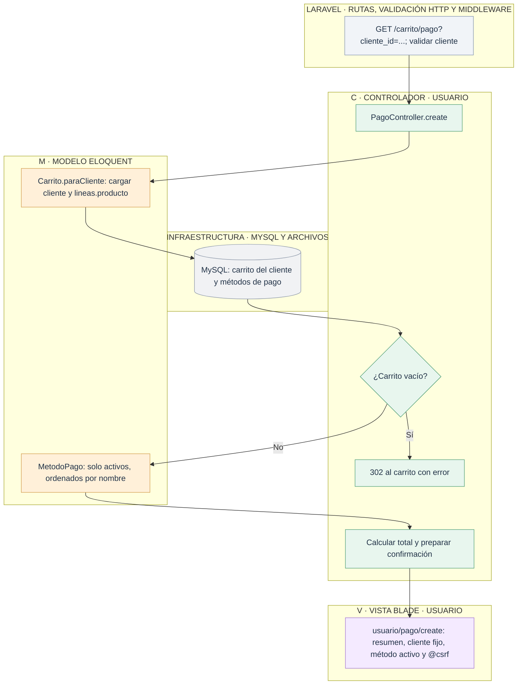
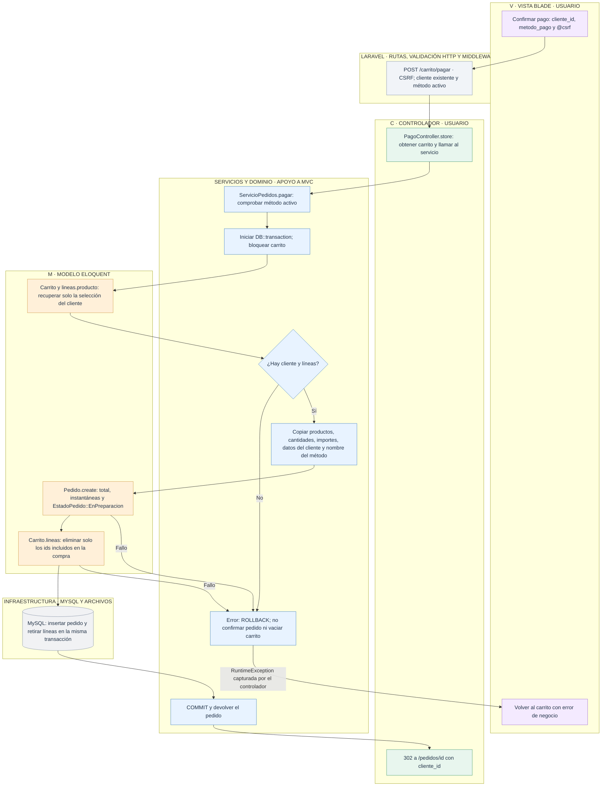

# Usuario: confirmar la compra simulada

[Índice de diagramas](../README.md) · **Área Usuario**

`PagoController` prepara la confirmación y delega la compra en `ServicioPedidos`. Solo se procesa el carrito del cliente seleccionado. No se solicitan datos bancarios.

## Mostrar la confirmación

## Guardar el pedido y retirar las líneas compradas

El estado inicial se guarda como **2 · En preparación**. El total se calcula con los importes aplicados de las líneas, aunque el catálogo haya cambiado. Los carritos de otros clientes permanecen intactos. Una segunda confirmación encuentra el carrito vacío y no crea otro pedido.

Si el método dejó de estar activo, el servicio lo rechaza antes de iniciar la transacción. [Consulta del pedido y el histórico](historico.md) · [Cambio de estado desde Admin](../admin/pedidos.md).

## Archivos para seguir el recorrido

- **Entrada HTTP:** [Rutas web](../../routes/web.php).
- **Controladores:** [PagoController](../../app/Http/Controllers/PagoController.php).
- **Modelos:** [Carrito](../../app/Models/Carrito.php) · [LineaCarrito](../../app/Models/LineaCarrito.php) · [Cliente](../../app/Models/Cliente.php) · [MetodoPago](../../app/Models/MetodoPago.php) · [Pedido](../../app/Models/Pedido.php).
- **Vistas Blade:** [usuario/pago/create](../../resources/views/usuario/pago/create.blade.php) · [usuario/pedidos/show](../../resources/views/usuario/pedidos/show.blade.php).
- **Servicios, reglas y configuración:** [Servicio de compra (ubicación orientativa)](../../app/Services/ServicioPedidos.php) · [Estados del pedido](../../app/Enums/EstadoPedido.php).
- **Layout público:** [Layout de Usuario](../../resources/views/layouts/usuario.blade.php) · [Layout general](../../resources/views/layouts/app.blade.php).
