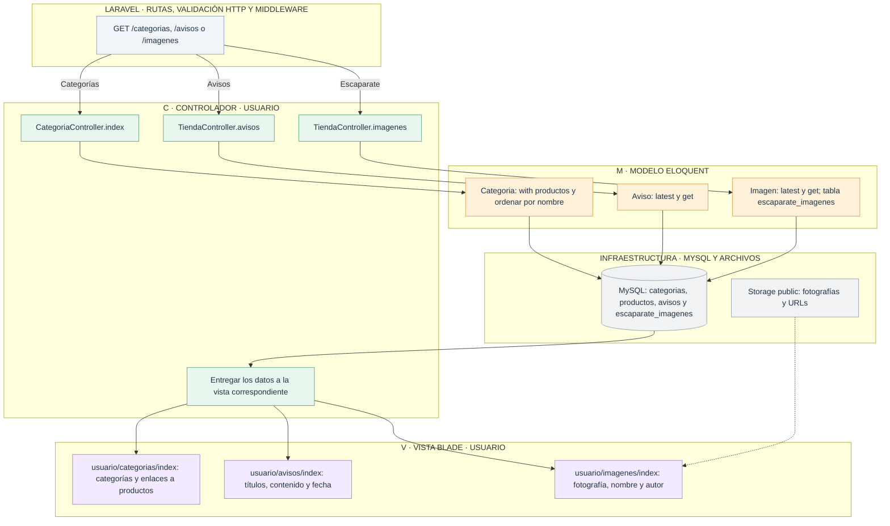
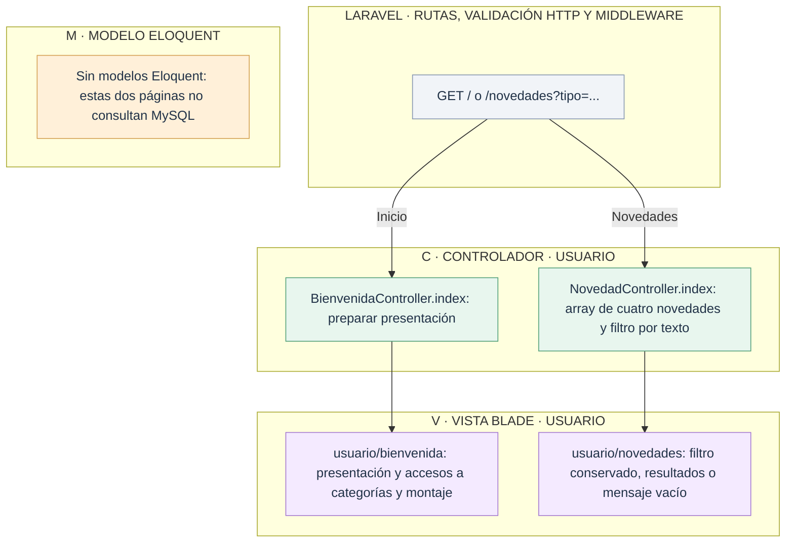

# Usuario: inicio, novedades, categorías, avisos y escaparate

[Índice de diagramas](../README.md) · **Área Usuario**

Estas páginas son de lectura. Los controles para crear, editar o borrar avisos, fotografías y productos están en Admin.

## Contenidos persistentes

## Presentación sin consultas a modelos

En novedades, `tipo` filtra un array definido en el controlador con textos como `periferico`. Es distinto del catálogo persistente, donde `TipoProducto` usa códigos enteros. El nodo de Modelo indica expresamente que no hay persistencia en este flujo.
