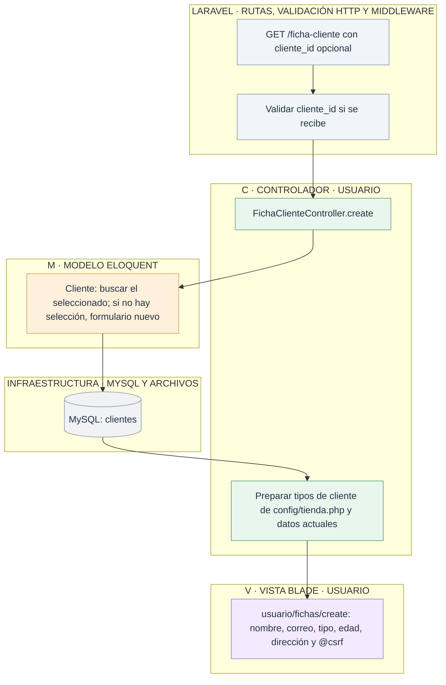
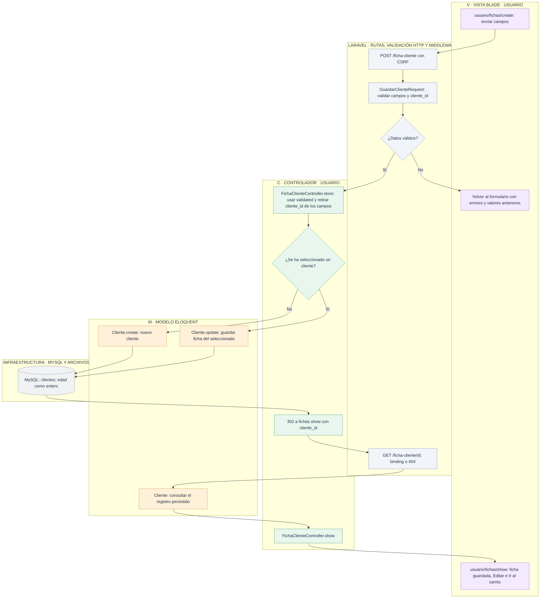

# Usuario: guardar y editar la ficha de cliente

[Índice de diagramas](../README.md) · **Área Usuario**

La ficha es **persistente**: guarda nombre, correo, dirección, tipo y edad en `clientes`. No es una simple previsualización. Sin cliente seleccionado crea uno; con `cliente_id` actualiza ese registro.

## Abrir el formulario

## Guardar y consultar después

El redirect después del POST permite recargar el detalle sin volver a enviar el formulario. Los clientes anteriores pueden tener tipo y edad sin indicar; el formulario público los exige para guardar su ficha. [La administración de clientes](../admin/clientes.md) permite gestionar los mismos registros.

## Archivos para seguir el recorrido

- **Entrada HTTP:** [Rutas web](../../routes/web.php).
- **Controladores:** [FichaClienteController](../../app/Http/Controllers/FichaClienteController.php).
- **Modelos:** [Cliente](../../app/Models/Cliente.php).
- **Vistas Blade:** [usuario/fichas/create](../../resources/views/usuario/fichas/create.blade.php) · [usuario/fichas/show](../../resources/views/usuario/fichas/show.blade.php).
- **Servicios, reglas y configuración:** [Validación de la ficha](../../app/Http/Requests/GuardarClienteRequest.php) · [Tipos y opciones de la tienda](../../config/tienda.php).
- **Layout público:** [Layout de Usuario](../../resources/views/layouts/usuario.blade.php) · [Layout general](../../resources/views/layouts/app.blade.php).
