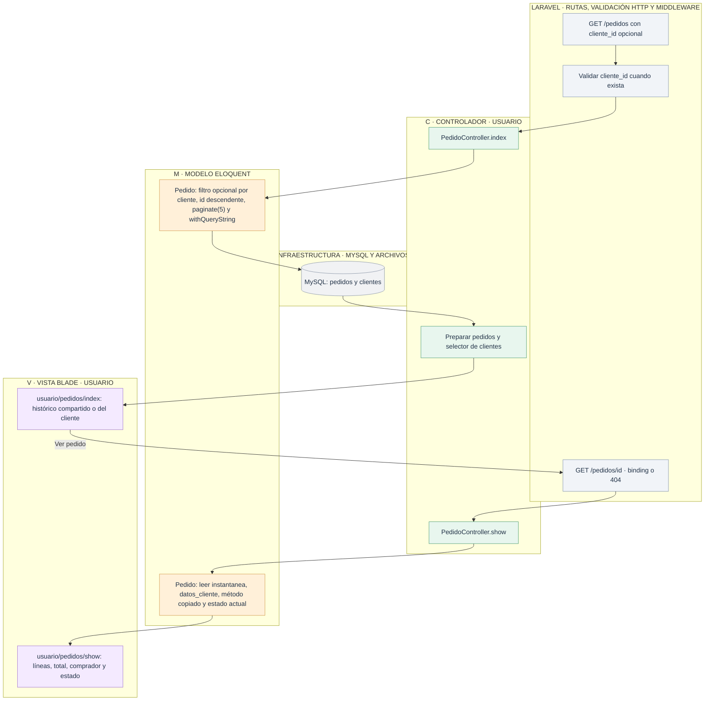

# Usuario: histórico compartido y pedidos del cliente

[Índice de diagramas](../README.md) · **Área Usuario**

`PedidoController.index` muestra todos los pedidos si no recibe cliente_id. Si se recibe, filtra por ese cliente. La consulta pública y los detalles están disponibles sin iniciar sesión.

La instantánea del pedido es un JSON de líneas con nombre de producto, cantidad e importe. **No existe una tabla lineas_pedido en el código actual.** Cambiar o borrar productos, clientes o métodos no reescribe el documento histórico. El nombre mostrado del estado sí refleja el último cambio hecho por Admin.

## Archivos para seguir el recorrido

- **Entrada HTTP:** [Rutas web](../../routes/web.php).
- **Controladores:** [PedidoController](../../app/Http/Controllers/PedidoController.php).
- **Modelos:** [Pedido](../../app/Models/Pedido.php) · [Cliente](../../app/Models/Cliente.php).
- **Vistas Blade:** [usuario/pedidos/index](../../resources/views/usuario/pedidos/index.blade.php) · [usuario/pedidos/show](../../resources/views/usuario/pedidos/show.blade.php).
- **Servicios, reglas y configuración:** [Estados del pedido](../../app/Enums/EstadoPedido.php).
- **Layout público:** [Layout de Usuario](../../resources/views/layouts/usuario.blade.php) · [Layout general](../../resources/views/layouts/app.blade.php).
