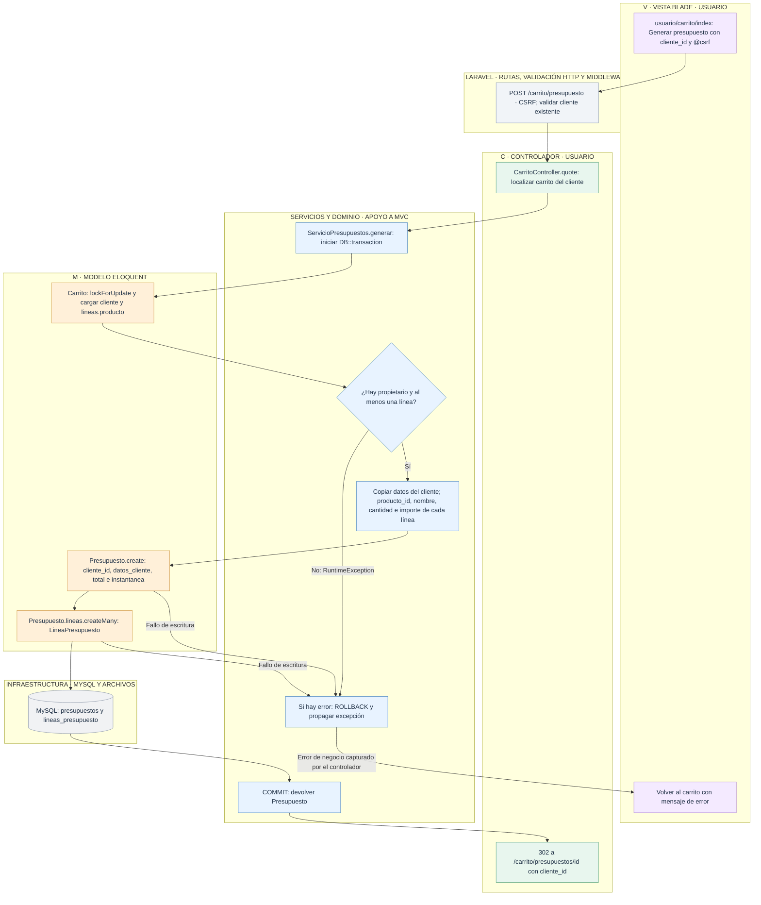
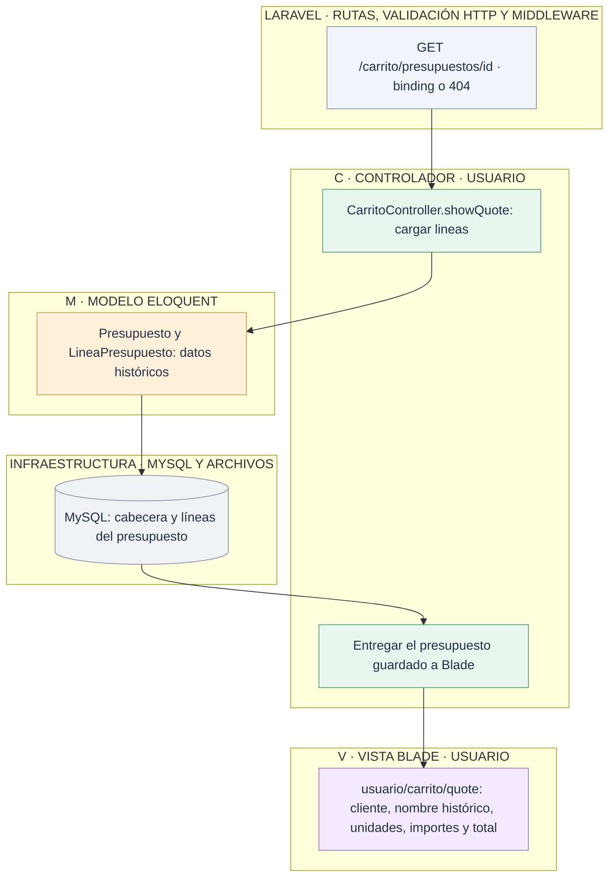

# Usuario: generar y consultar presupuestos históricos

[Índice de diagramas](../README.md) · **Área Usuario**

El presupuesto pertenece al cliente del carrito y contiene líneas relacionadas con productos. Generarlo conserva el carrito y no efectúa un pago.

## Generación en una única transacción

El controlador transforma `RuntimeException` en un error del carrito. Las demás excepciones siguen hacia el manejador de Laravel tras revertirse la transacción. La cabecera y todas las líneas quedan guardadas juntas, o ninguna se confirma.

## Consultar el documento sin recalcularlo

Los nombres e importes no cambian al editar el catálogo. Si se borra un producto, `lineas_presupuesto.producto_id` queda a NULL y se conserva `producto_nombre`. Si se borra el cliente, `presupuestos.cliente_id` queda a NULL y permanece `datos_cliente`.
