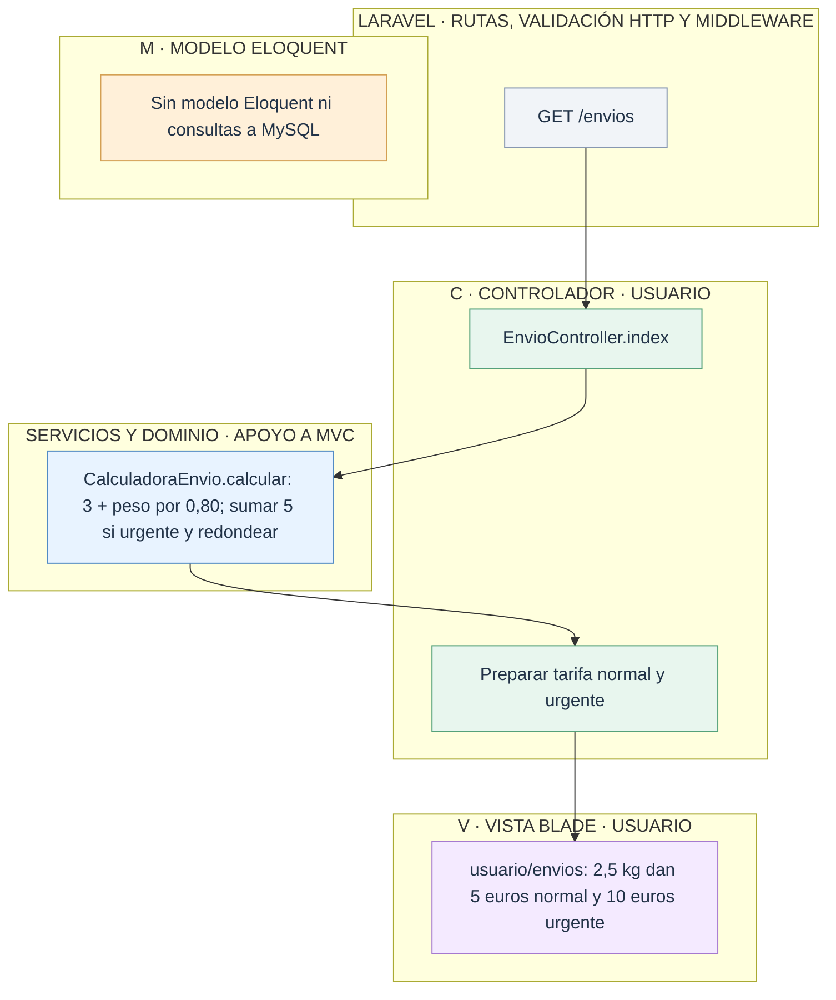
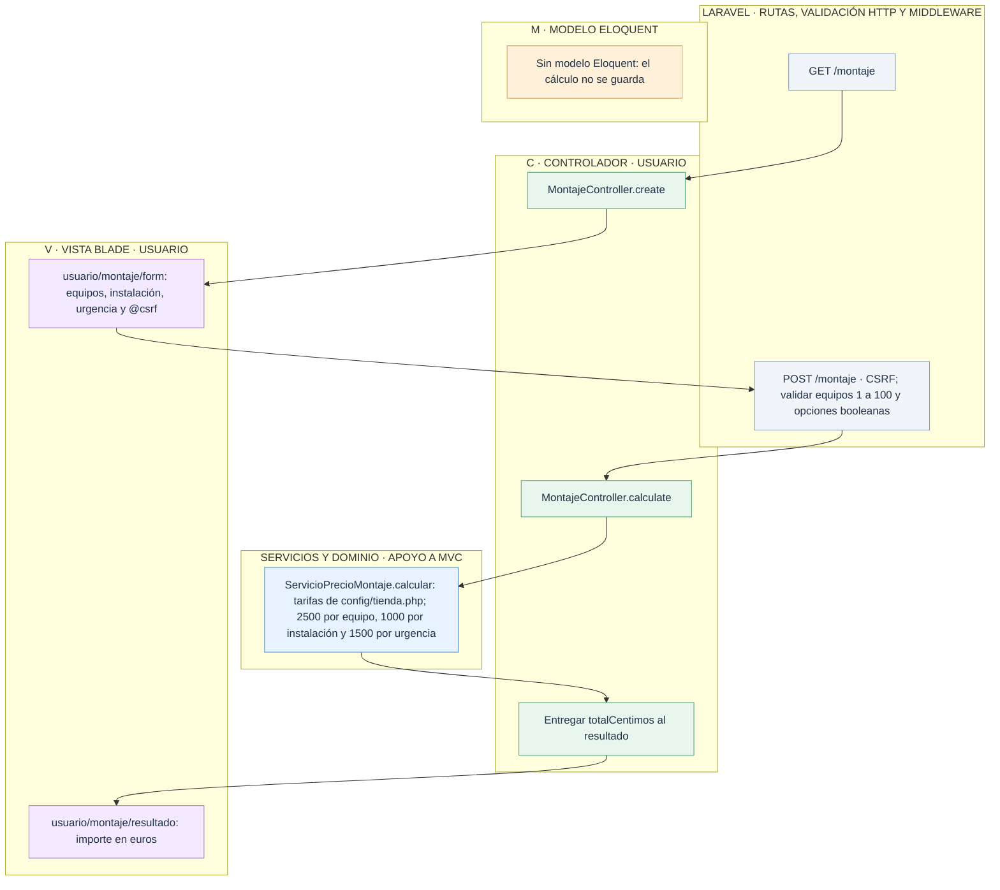
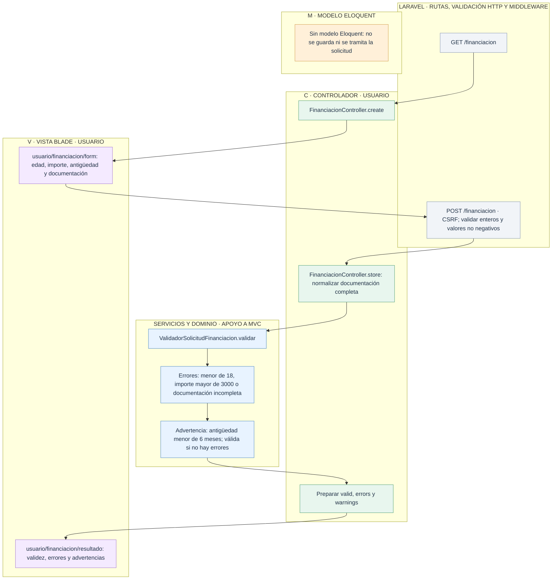

# Usuario: envío, montaje y financiación

[Índice de diagramas](../README.md) · **Área Usuario**

Estos cálculos no crean encargos ni financiación real. Los servicios no son vistas ni controladores, y se distinguen de los modelos Eloquent. El nodo M indica que no hay persistencia en estos flujos.

## Tarifas de envío

Clase de dominio: `app/Dominio/Envios/CalculadoraEnvio.php`. Se calculan dos casos fijos de 2,5 kg.

## Presupuesto de montaje

Los errores de formato vuelven al formulario. La instalación se cobra por equipo y la urgencia una vez por encargo. Dos equipos con instalación y urgencia suman 8500 céntimos, es decir, 85 €.

## Simular financiación

Los límites son reglas ficticias de la actividad. Los errores de formato HTTP y los errores de negocio son comprobaciones distintas; una advertencia por sí sola no invalida la solicitud.

## Archivos para seguir el recorrido

- **Entrada HTTP:** [Rutas web](../../routes/web.php).
- **Controladores:** [EnvioController](../../app/Http/Controllers/EnvioController.php) · [MontajeController](../../app/Http/Controllers/MontajeController.php) · [FinanciacionController](../../app/Http/Controllers/FinanciacionController.php).
- **Vistas Blade:** [usuario/envios](../../resources/views/usuario/envios.blade.php) · [usuario/montaje/form](../../resources/views/usuario/montaje/form.blade.php) · [usuario/montaje/resultado](../../resources/views/usuario/montaje/resultado.blade.php) · [usuario/financiacion/form](../../resources/views/usuario/financiacion/form.blade.php) · [usuario/financiacion/resultado](../../resources/views/usuario/financiacion/resultado.blade.php).
- **Servicios, reglas y configuración:** [Cálculo de envíos](../../app/Dominio/Envios/CalculadoraEnvio.php) · [Precio de montaje (ubicación orientativa)](../../app/Dominio/Montaje/ServicioPrecioMontaje.php) · [Validador de financiación (ubicación orientativa)](../../app/Dominio/Financiacion/ValidadorSolicitudFinanciacion.php) · [Tarifas de montaje](../../config/tienda.php).
- **Layout público:** [Layout de Usuario](../../resources/views/layouts/usuario.blade.php) · [Layout general](../../resources/views/layouts/app.blade.php).
