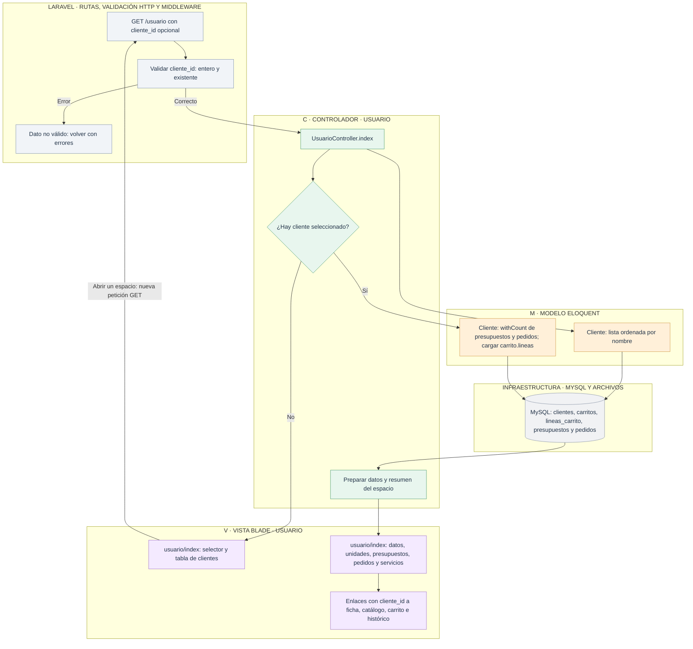

# Usuario: elegir cliente y abrir Tu Espacio

[Índice de diagramas](../README.md) · **Área Usuario**

`UsuarioController.index` atiende GET `/usuario`. Sin selección muestra clientes disponibles; con `?cliente_id=...` muestra el espacio de ese cliente. Elegir cliente no equivale a iniciar sesión.

La selección viaja en la URL y en los formularios, sin una sesión o cookie de selección. La página principal de Usuario no muestra Volver. Las páginas interiores sí lo mantienen. `layouts/app` aporta Usuario, Admin y Carrito; `layouts/usuario` aporta la navegación pública; `usuario/_menu-espacio` reúne los accesos del espacio.
